<div align="center">

# ACE Pro for Klipper

**Run an Anycubic ACE Pro multi-material unit (or two, or three) on any Klipper printer.**
One installer for **Klipper**, **Kalico** and **Simple AF**.
Tuned and tested on a **Creality K1 Max** (Raspberry Pi 5, Kalico, Fluidd, KlipperScreen) with two ACE Pro units (T0–T7).

[](https://www.gnu.org/licenses/gpl-3.0)
[](https://www.python.org/)
[](https://www.klipper3d.org/)
[](fluidd/)
[](orca_plugin/)


</div>

---

## Contents

1. [What you get](#1-what-you-get)
2. [Hardware and wiring](#2-hardware-and-wiring)
3. [Install](#3-install)
4. [Configure your printer](#4-configure-your-printer)
5. [Slicer setup (OrcaSlicer)](#5-slicer-setup-orcaslicer)
6. [Choose spools at print start](#6-choose-spools-at-print-start)
7. [Fluidd ACE panel](#7-fluidd-ace-panel)
8. [KlipperScreen panel](#8-klipperscreen-panel)
9. [Calibrate the filament cutter](#9-calibrate-the-filament-cutter)
10. [Everyday use and commands](#10-everyday-use-and-commands)
11. [Endless spool](#11-endless-spool)
12. [Connection supervision](#12-connection-supervision)
13. [Update and undo](#13-update-and-undo)
14. [Troubleshooting](#14-troubleshooting)
15. [CFS purge chute variant (K1 Max, untested)](#15-cfs-purge-chute-variant-k1-max-untested)
16. [Repository layout](#16-repository-layout)
17. [Credits and license](#17-credits-and-license)

---

## 1. What you get

| | |
|---|---|
| **Klipper, Kalico and Simple AF** | Not tied to Anycubic hardware. Voron, RatRig, Creality K1 and others work. The installer asks which software you run and sets up the right files ([section 3](#3-install)). |
| **1–3 ACE Pro units** | T0–T3, T4–T7, T8–T11. Tested with two units. |
| **Full tool changes** | Retract, cut, unload, load, purge, wipe, all driven by `T0`…`T7`. |
| **Filament cutter** | `CUT_TIP` with a step-by-step calibration (`cut_calibrate.cfg`). |
| **Servo poop basket** | Deploys for heating, purging and wiping, then retracts. Optional: the installer switches it off if you have none. |
| **Spool mapping at print start** | Pick which physical spool prints each sliced filament. No re-slicing. |
| **Fluidd panel** | An ACE card with four layouts, a tool-change progress bar, dryer presets, a cutter wizard, counters and a "Choose ACE spools" window at print start ([section 7](#7-fluidd-ace-panel)). |
| **OrcaSlicer plugin** | The same choice inside Orca, written into the G-code when you send it. |
| **KlipperScreen panel** | Slots, load/unload, dryer and endless spool from the touchscreen. |
| **Endless spool** | Switches to a matching spool when one runs out, or to the spools you list for that tool in order. |
| **Counters** | Tool changes, filament cuts and purged filament, shown in Fluidd. |
| **Moonraker `lane_data` sync** | Orca sees the loaded filament types and colours. |
| **RFID sync** | Reads material, colour and temperature from the ACE tags. |
| **Safety** | Connection supervision, runout and tangle handling, recovery after a failed load. |

<div align="center">
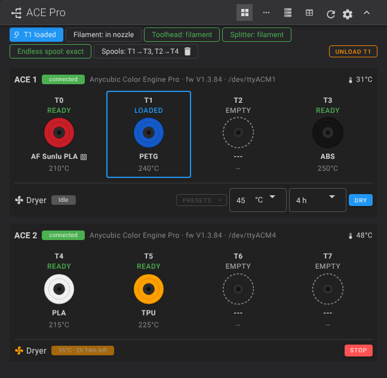<br>
<em>The ACE Pro card on the Fluidd dashboard (demo data).</em>
</div>

---

## 2. Hardware and wiring

What you need, how to connect the ACE Pro by USB, and the machine this repository is tuned on. (The same guide is also in [`docs/HARDWARE.md`](docs/HARDWARE.md).)

> The connector pinouts below come from the Kobra-S1/ACEPRO documentation and community adapter builds. They are not re-measured on every unit, so **check your adapter with a multimeter before plugging it in** (section 2.4).

### 2.1 What you need

| Part | Required | Notes |
|---|---|---|
| 1 to 3 Anycubic Color Engine Pro units | Yes | Tested here with two (T0–T7). |
| USB cable or adapter for each ACE | Yes | Section 2.3 shows how to build one. |
| **Toolhead filament sensor** (close to the hotend) | Yes | Detects runout and tells the driver when filament reaches the nozzle. |
| **RDM sensor** (the splitter or "return module") | Optional | Lets the driver check the path and confirm an unload. |
| **Filament cutter** | Recommended | Gives clean tool changes. This setup uses a mechanical cutter pushed by the toolhead (section 9). |
| Poop bucket and servo basket | Optional | Catches the purge. The servo here is an EZMAX ES3004. |
| Klipper host with free USB ports | Yes | A Pi 5 with a USB HAT works. Use a powered hub if the ports are weak. |

The sensor pins are set in `acepro.cfg` (section 4.2).

### 2.2 Which ACE do you have?

| Unit | What the 4-pin connector carries | What to use |
|---|---|---|
| **ACE Pro** (first generation) | Native USB data | A plain USB-A adapter (below). It appears in Linux as `/dev/ttyACM*`. |
| **ACE 2 Pro** | RS-485, not USB | The RS485-to-USB conversion cable from Anycubic's ACE 2 kit for the KS1 / K3. A home-made USB cable will not work, and the Kobra-X / KS1-Max cable is not the same part. |

The driver detects which protocol a unit speaks (`protocol: auto` in `acepro_setting.cfg`). The rest of this section is about the first-generation ACE Pro, which this setup uses.

### 2.3 USB adapter for the ACE Pro

<div align="center">
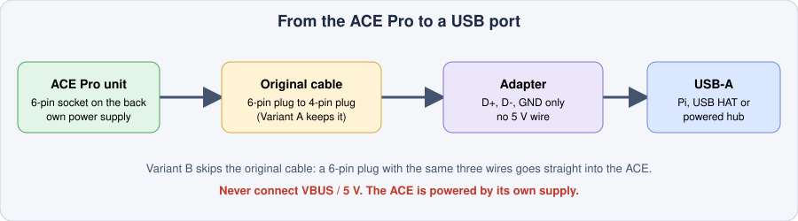
</div>

Only **three wires** are used: **D+, D- and GND**. Do **not** connect VBUS (5 V). The ACE has its own power supply, and a second 5 V source on the data cable can damage the Pi or the unit.

The stock cable has a 6-pin plug for the ACE's socket and a 4-pin plug that normally goes into an Anycubic printer. You can adapt either end:

| | Variant A: adapt the printer end | Variant B: adapt the ACE end |
|---|---|---|
| Original cable | Kept as it is | Not used |
| You build | A 4-pin socket to USB-A adapter | A 6-pin plug to USB-A cable |
| Donor part | A 4-pin ACE extension cable (cut one end off) | A 6-pin plug or pigtail |
| Good if | You want to keep the original cable and be able to go back to it | You want the shortest path or a tidy back cover |

<div align="center">
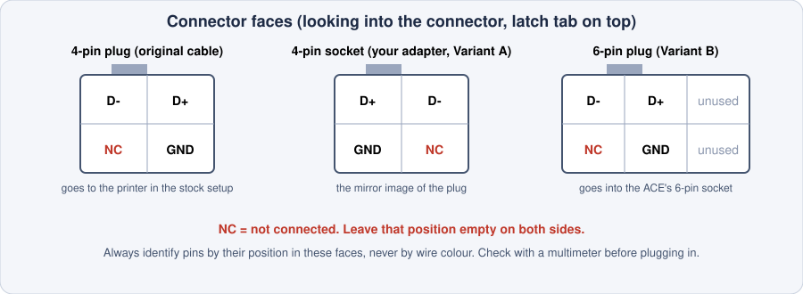
</div>

| ACE signal | USB-A pin |
|---|---|
| D+ | 3 |
| D- | 2 |
| GND | 4 |
| NC (not connected) | 1 (VBUS), left unconnected |

- The plug and the socket faces are mirror images of each other. That is normal for connectors that mate.
- Find each pin by its **position** in the diagram, never by wire colour. Colours differ between cable makers.
- The 6-pin plug has the same 2×2 signal block in two columns, plus a third column with no contacts.

Ready-made options: [printable USB-A adapter](https://www.printables.com/model/1163780-anycubic-ace-pro-usb-a-adapter) and [printable USB-C back cover](https://www.printables.com/model/1227630-anycubic-acepro-back-cover-for-usb-c). Pinout documentation: [Kobra-S1/ACEPRO](https://github.com/Kobra-S1/ACEPRO).

### 2.4 Check before you plug in

With a multimeter (no ACE connected, nothing powered):

1. **Continuity:** D+ to USB pin 3, D- to USB pin 2, GND to USB pin 4.
2. **No shorts:** D+ to D-, D+ to GND and D- to GND must not beep.
3. **VBUS:** USB pin 1 must not be connected to anything on the ACE side.

Then plug it in, power the ACE and, on the Pi:

```bash
ls /dev/serial/by-id/          # the ACE should be listed
```

Restart Klipper and run `ACE_GET_STATUS`.

### 2.5 My setup

This is the machine the configs in [`config/`](config/) are written for. If yours differs, the values in section 4 are the ones to change.

| Part | What I use |
|---|---|
| Printer | Creality K1 Max (CoreXY, TMC2209 sensorless homing) |
| Host | Raspberry Pi 5 with an NVMe drive |
| USB | Waveshare PCIe → M.2 **USB HAT+** (the ACE units, the toolhead MCU and the expander board plug into it) |
| Firmware | Kalico (Klipper fork) + Moonraker |
| Web UI | Fluidd 1.37.7 (with the ACE panel from this repo) |
| Touchscreen | KlipperScreen, 1024×600 |
| ACE | Two ACE Pro units → T0–T3 and T4–T7 |
| Cutter | Mechanical cutter block at the back-left, pushed by the toolhead moving along X |
| Poop basket | EZMAX ES3004 servo on `PB14` |
| Slicer | OrcaSlicer 2.5 on macOS |

<div align="center">
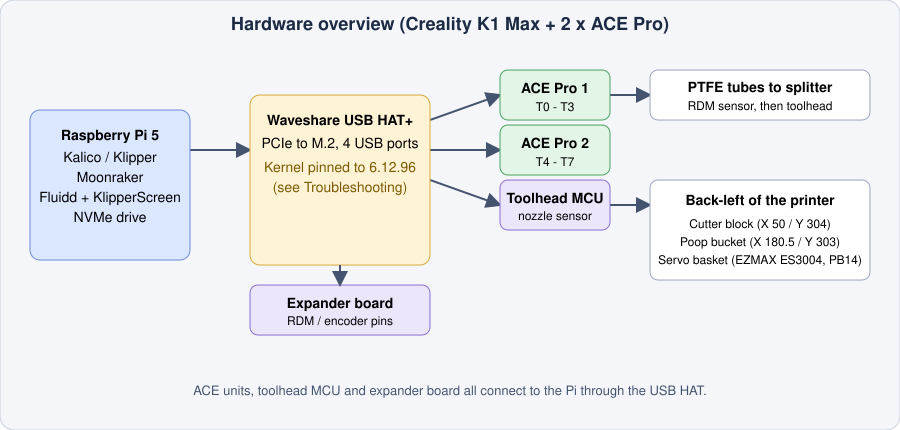
</div>

On a Pi 5 with the Waveshare USB HAT+, a kernel update broke the HAT's USB controller on my printer. See "Raspberry Pi 5 + USB HAT" in section 14.

Important positions in `acepro_macros.cfg`:

| Setting | Value | Meaning |
|---|---|---|
| `cut_block_x / y` | 50 / 304 | Where the cutter sits |
| `cut_engage_x / y` | 43 / 304 | Where the lever starts to move |
| `cut_full_x / y` | **33** / 304 | Where the blade is fully closed (never go past this) |
| `cut_repetitions`, `cut_pause_ms` | 2, 150 | Cutting cycles and pause at the full position |
| `poop_x / y` | 180.5 / 303 | Waste bucket |
| `servo_deploy_angle` | 87° | Basket open |

---

## 3. Install

### 3.1 Requirements

- Klipper, Kalico or Simple AF (Pellcorp) with Python 3.9+, running Moonraker.
- One to three ACE Pro units connected by USB (a powered hub or HAT is fine).
- A **filament sensor at the toolhead** (the driver needs it). A sensor after the splitter (RDM) and the ACE encoder are optional.
- SSH access to the Pi.

### 3.2 Driver (one-command installer)

```bash
sudo apt-get update
sudo apt-get install -y git
cd ~
git clone -b dev https://github.com/ducati1198/acepro-any-klipper
cd acepro-any-klipper
chmod +x installer.sh
./installer.sh
```

> **"destination path 'acepro-any-klipper' already exists"?** You already downloaded it once. Do not clone again. Update the folder instead:
>
> ```bash
> cd ~/acepro-any-klipper
> git pull
> ./installer.sh --update
> ```
>
> If `git pull` complains about local changes, see [section 13](#13-update-and-undo).

The installer asks a few plain questions, shows exactly what it will change, and only then does it. It saves a backup first, so `./installer.sh --undo` puts everything back.

**The questions** (each has a one-line reason and a safe default):

1. Which software: **Klipper**, **Kalico** or **Simple AF**. It suggests one by looking at your Pi.
2. How many ACE units, and the pin of your toolhead filament sensor. Do you also have an RDM sensor or the ACE encoder?
3. Do you have the **servo poop basket**? (If not, the servo is switched off and left out of your config.)
4. Do you have a **filament cutter** and a **poop bucket**? (If not, those macros are switched off.)
5. Optional extras: Fluidd ACE panel, KlipperScreen menu, Spoolman helpers, cutter calibration.

**What it does:**

1. Links the ACE driver (`extras/ace/`), `virtual_pins` and the ACE temperature sensor into Klipper's `extras` folder.
2. Removes the old ACE web dashboard links, if an earlier install added them.
3. Checks that `pyserial` and `jinja2` are available and that the driver compiles.
4. Copies the ACE config files into your config folder and adds `[include acepro.cfg]` at the top of `printer.cfg`.
5. Checks the result **before** it writes anything, and again before restarting Klipper.
6. Installs the Fluidd panel and the KlipperScreen menu if you chose them.
7. Restarts Klipper, waits for it, and runs a **self-test** (Klipper ready, driver loaded, units found).
8. Prints your next steps, including the exact OrcaSlicer start G-code for your setup.

**More commands:**

| Command | What it does |
|---|---|
| `./installer.sh --update` | Update the driver and macros. Your values (positions, speeds, pins) are kept. |
| `./installer.sh --check` | Look for problems. Changes nothing. |
| `./installer.sh --repair` | Restore the driver links and the include line (use it after a Simple AF or Fluidd update). |
| `./installer.sh --undo` | Put back the files saved before the last install. |
| `./installer.sh --uninstall` | Remove everything the installer added (saved first, so `--undo` brings it back). |
| `./installer.sh --doctor` | Find problems, explain each one, and offer a fix. Asks before it changes anything. |
| `./installer.sh --dry-run` | Go through the questions and show what would change. Changes nothing. |
| `./installer.sh --support-bundle` | Collect config (passwords and tokens removed) and logs to share when something fails. |

**Your positions start locked.** The cutter, poop bucket, wipe and park positions in a new install are placeholders. Moves to them stop with a message until you measure them (section 4.3) and set `variable_positions_confirmed: True`. This is on purpose: the sample numbers come from a Creality K1 Max.

#### Klipper

Pick **Klipper**. You get everything: the ACE `PAUSE` / `RESUME` (in `acepro_printer_macros.cfg`), which pause, retract, deploy the servo and reload the tool on resume. `MY_START_PRINT` hands over to your own `START_PRINT`. If another file of yours (for example Mainsail's or Fluidd's `client.cfg`) also defines `PAUSE` / `RESUME` and is loaded after `[include acepro.cfg]`, its version wins; `./installer.sh --check` lists it as a note. Move `[include acepro.cfg]` below that include to use the ACE versions.

#### Kalico

Pick **Kalico**. Same files as Klipper. The installer also warns if a heater has no `control:` line, because Kalico stops at start-up with `pid_profile ... 'control' has to be specified`.

#### Simple AF

Pick **Simple AF**. The installer follows Simple AF's rules:

- `PAUSE` and `RESUME` are in `acepro_printer_macros.cfg` on every profile. Simple AF's `client.cfg` defines them too and is loaded after the ACE files, so on Simple AF its own versions stay in charge.
- All files go in the main config folder (not a subfolder), so Simple AF's `pellcorp-overrides` backup keeps them across `installer.sh --update`.
- It never edits `moonraker.conf` or any other file Simple AF owns.
- **Hooks file `my_saf_hooks.cfg`.** The installer asks if it may add `[include my_saf_hooks.cfg]` to `printer.cfg`, or if you will add that line yourself in Fluidd (it then tells you where). If you already have a `my_saf_hooks.cfg`, it is **updated, not replaced**: your own lines stay as they are, and the ACE lines go at the **top** of each hook macro. `ZERO_OUT_SERVO` is the first line of every hook (homing, heating bed, bed mesh, heating nozzle, start print, end print end, cancel, pause, resume, and filament runout or nozzle wipe if you have those), and the encoder line comes right after it (`SFS_ENABLE_ACE_ENCODER` in `_SAF_START_PRINT_END`, `SFS_DISABLE_ACE_ENCODER` in `_SAF_ON_CANCEL`). The one exception is `_SAF_END_PRINT_START`: the encoder line is on top and `ZERO_OUT_SERVO` stays below it, before the unload. If you have no servo, no `ZERO_OUT_SERVO` lines are added (yours stay). The two encoder lines are added only if you said you have the ACE encoder sensor; if you said no, they are removed. Hooks that another file already defines are left alone and listed at the end. The old copy is in the backup (`--undo` restores it).
- **Pause and resume follow the ACE switch.** Simple AF's `PAUSE` and `RESUME` stay in charge and call two hooks, `_SAF_ON_PAUSE` and `_SAF_ON_RESUME`, which the hooks file points at `_ACE_ON_PAUSE` and `_ACE_ON_RESUME`. With the `ACE_Pro` switch **off** they do nothing (pure Simple AF). With it **on**: on pause the servo is retracted, the filament is retracted a little and the nozzle standby timer starts; on resume the nozzle is reheated, the ACE tool is reloaded if there is no filament at the nozzle (or a tool change was left half done), otherwise the nozzle is purged and wiped over the poop bucket. Simple AF still parks and returns the head itself.
- A Simple AF update only runs `git reset --hard` on its Klipper copy, so the links usually survive. Run `./installer.sh --repair` afterwards to be sure.
- Keep the start line `MY_START_PRINT TOOL=... ` (section 5.1). It loads the tool and then runs Simple AF's `START_PRINT`.

**Safety checks the installer makes first:**

- It **stops if a print is running or paused** (there is no override). `--check`, `--support-bundle` and `--dry-run` still work.
- It warns, and carries on, if it **sees no ACE on USB**.
- It finds `printer_data` in other places: several Klipper instances (you pick one) and the Creality K1 native layout (`/usr/data`, experimental, no systemd or sudo). It also checks for sudo and the Klipper service name.
- If a file uses a `virtual_pin:` before `[virtual_pins]` loads, it explains and offers to add `[virtual_pins]` at the top of `printer.cfg` (saved first).

### 3.3 Check `printer.cfg`

The installer adds these for you (`[force_move]` only if you have a cutter). Check they are there:

```ini
[include acepro.cfg]

[force_move]
enable_force_move: True      # needed by CUT_TIP
```

`[save_variables]` is already created by `acepro_setting.cfg` (it stores inventory and tool state).

Restart Klipper:

```bash
sudo systemctl restart klipper
```

Then run `ACE_GET_STATUS` in the console. You should see every ACE unit connected with its four slots.

### 3.4 Fluidd ACE panel

Installed by the installer (step 4 above). Manual steps and building it yourself: [section 7](#7-fluidd-ace-panel).

### 3.5 OrcaSlicer plugin

Runs on your computer, so the installer can only show the steps. Copy it over and install it from Orca: [section 5.3](#53-ace-spool-mapper-plugin).

> **After any install or update, hard-refresh the browser** so Fluidd loads the new files:
> Windows/Linux `Ctrl+Shift+R` · macOS `Cmd+Shift+R`.

---

## 4. Configure your printer

All settings are commented in the files. The ones to check first:

| File | What it holds |
|---|---|
| `acepro_setting.cfg` | `[ace]` hardware settings: unit count, feed/retract speeds, tube lengths, purge, Moonraker sync. Also the virtual switches `ACE_Pro`, `endless_spool`, `AUTO_UNLOAD`. |
| `acepro_macros.cfg` | `_ACE_VARS`: cutter, poop bucket, wipe, servo and park positions. Tool-change macros. |
| `acepro_printer_macros.cfg` | `PAUSE`, `RESUME`, `LOAD_FILAMENT`, `UNLOAD_FILAMENT`, `PARK_FOR_CANCEL`, purge helpers and `MY_START_PRINT`. |
| `acepro_servo.cfg` | `[servo servo_wipe]` with your pin. Not there if you have no servo. |
| `my_saf_hooks.cfg` | Simple AF hooks with the ACE steps (Simple AF only). An existing file is updated, not replaced. |
| `acepro-install.conf` | The answers you gave the installer. `--update` reuses them. |
| `acepro.cfg` | Filament sensors, encoder, `CUT_TIP`, poop and wipe moves, servo handling. |
| `cut_calibrate.cfg` | Optional cutter calibration macros (section 9). |

### 4.1 Number of ACE units

```ini
[ace]
ace_count: 2        # T0-T3 on unit 0, T4-T7 on unit 1, T8-T11 on unit 2
```

Per-unit values use the comma syntax, for example `feed_speed: 60,1:45` (unit 0: 60, unit 1: 45).

### 4.2 Filament sensors

The driver **needs** a toolhead (nozzle) sensor. A splitter (RDM) sensor and the encoder are optional; the installer leaves their sections out if you say you don't have them:

```ini
[filament_switch_sensor filament_runout_nozzle]
switch_pin: !nozzle_mcu:PA10        # your own pin
pause_on_runout: True

[filament_switch_sensor filament_runout_rdm]
switch_pin: PC15                    # your own pin
pause_on_runout: False
```

Tell the driver their names in `acepro_setting.cfg`:

```ini
filament_runout_sensor_name_nozzle: filament_runout_nozzle
filament_runout_sensor_name_rdm: filament_runout_rdm
```

`acepro.cfg` also defines an encoder (`filament_motion_sensor ace_encoder`) that pauses if the extruder blocks. Change the pins to match your wiring.

### 4.3 Positions to measure on your printer

**Easiest: the wizard in Fluidd.** Run `ACE_SETUP_CUTTER` or `ACE_SETUP_BUCKET` in the console. It homes X and Y if needed, then lists the points. You jog the head with Fluidd's jog buttons and save each point with `ACE_SETUP_SAVE POINT=<name>` (names: `cut_block`, `cut_engage`, `cut_full`, `poop`, `osc_start`, `osc_stop`, `wipe_start`). Each save writes the X/Y into `acepro_macros.cfg` and into the running macros, so no restart is needed (the first time, the old file is kept as `acepro_macros.cfg.before-setup`). When you are sure, run `ACE_SETUP_CONFIRM` to unlock the cutter, bucket and wipe moves. The wizard is refused during a print and never moves the head except to home X and Y.

Run `ACE_SELFTEST` any time for a read-only health check: the driver, each unit's connection, temperatures, sensors, whether positions are confirmed, and the switches. Nothing moves.

**By hand:** edit these in `_ACE_VARS` (`acepro_macros.cfg`):

- **Cutter:** `cut_block_*`, `cut_engage_*`, `cut_full_*` (use the calibration in section 9).
- **Poop bucket:** `poop_x`, `poop_y`, plus the shake and oscillation values.
- **Wipe:** `wipe_start_x/y`, `wipe_length`, `wipe_pattern` (`STRAIGHT` or `ZIGZAG`).
- **Servo:** pin in `acepro_servo.cfg`, and `servo_deploy_angle`, `servo_retract_angle`, `servo_min_z` in `_ACE_VARS`.

What you have is switched on or off in `_ACE_VARS`: `servo_enable`, `cutter_enable`, `poop_enable`. Without a poop bucket the purged filament lands where the nozzle is.

When all positions are measured, set `variable_positions_confirmed: True`. Until then `TO_THROW_POSITION`, `CUT_TIP` and everything that uses them stop with a message instead of moving.

**A fixed brush instead of a servo wiper?** The ACE's own wipe moves (`wipe_start_x/y`, `wipe_length`, `wipe_qty`, `wipe_pattern`) work over a fixed brush; no servo is needed. If you want a separate `WIPE_NOZZLE` macro (brush on the bed or the frame, with or without a servo), see the example [`examples/servo_wiper.cfg`](examples/servo_wiper.cfg). The installer never installs it.

### 4.4 Temperature sensors

`acepro_setting.cfg` has a `temperature_ace` sensor per unit (`acepro_temp_1`, `_2`, `_3`). The installer keeps the first N for the N units you chose and comments out the rest.

---

## 5. Slicer setup (OrcaSlicer)

### 5.1 Machine start G-code

Replace the call to `START_PRINT` with `MY_START_PRINT`. It loads the first tool through the ACE (skipping the reload if that tool is already at the nozzle), heats, cools down to a safe temperature, and then continues into your own `START_PRINT`.

```gcode
M140 S0
M104 S0
MY_START_PRINT TOOL={initial_tool} BED_TEMP=[bed_temperature_initial_layer_single] EXTRUDER_TEMP=[nozzle_temperature_initial_layer]
SET_PRINT_STATS_INFO TOTAL_LAYER=[total_layer_count]
```

**Machine end G-code:** keep your normal `PRINT_END`.

### 5.2 Layer change G-code

```gcode
;AFTER_LAYER_CHANGE
SET_PRINT_STATS_INFO CURRENT_LAYER={layer_num + 1}
M117 Layer {layer_num+1}/[total_layer_count] : {filament_settings_id[0]}
```

Also check:

- **Printer settings → Multimaterial:** enable *Single extruder multi-material* and set the filament count to the number of ACE slots you use.
- **Printer settings → Connection:** host set to your Pi, for example `192.168.1.50:7125` (Moonraker).
- **Flush/purge:** [`slicer/orca_flush_to_purgelength.py`](slicer/orca_flush_to_purgelength.py) converts Orca's flush volumes into purge lengths.

### 5.3 ACE Spool Mapper plugin

The plugin lets you choose the physical spool for each sliced filament inside Orca. Full guide: [`orca_plugin/INSTALL.md`](orca_plugin/INSTALL.md).

<div align="center">
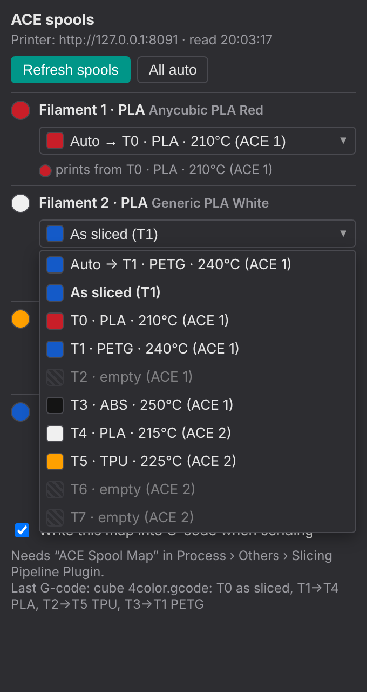
</div>

1. In OrcaSlicer 2.5 or newer open **File → Plugins**.
2. **Browse plugins → Install local plugin** and pick `orca_plugin/ace_spool_mapper.py`.
3. Click **Yes** when Orca asks whether the plugin may connect to your printer.
4. Enable the two parts: **ACE Spools** (the panel) and **ACE Spool Map** (the G-code step).
5. Switch Orca to **Advanced** mode, open **Process → Others → Slicing Pipeline Plugin**, add **ACE Spool Map** and save the process preset. Do this for each process preset you print with.
6. Restart Orca. The **ACE Spools** panel docks beside the 3D view.

Each project filament shows its best match (**Auto →**: same material, closest colour, every spool used once). Change any row, slice, then use **Upload and Print** as usual. A swatch next to each spool shows its colour.

---

## 6. Choose spools at print start

<div align="center">
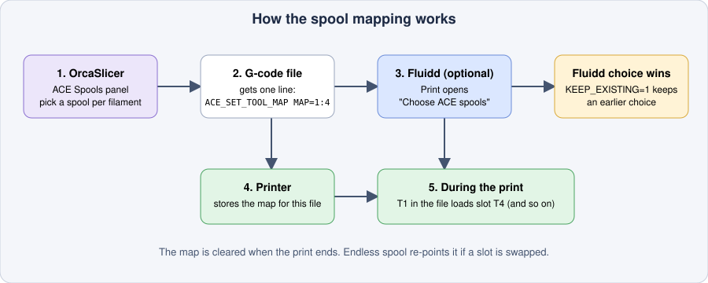
</div>

Print a file with any loaded spools, without re-slicing. The G-code's `T0`, `T1`… are mapped to physical ACE slots **for that one print**.

| Command | What it does |
|---|---|
| `ACE_SET_TOOL_MAP MAP=0:3,2:0 FILE="name.gcode"` | Sliced T0 prints from slot T3, sliced T2 from slot T0 |
| `ACE_SET_TOOL_MAP … KEEP_EXISTING=1` | Does nothing if a choice was already made for this file |
| `ACE_GET_TOOL_MAP` | Shows the active map |
| `ACE_CLEAR_TOOL_MAP` | Clears it |

Rules:

- Only `T<n>` is remapped. `ACE_CHANGE_TOOL` is not, so `RESUME` reloads the real spool.
- The map only applies while that file prints and is cleared when the print ends.
- Endless spool re-points the map when it switches to another slot.
- The status is in the `ace` object: `tool_map`, `tool_map_file`, `tool_map_active`.

Three ways to set it, in order of convenience:

| Where | How |
|---|---|
| **OrcaSlicer** | The ACE Spools panel (section 5.3). The line is written into the G-code you send. |
| **Fluidd** | Press **Print** (or **Re-print**) on a file and the **Choose ACE spools** window opens ([details](#choose-ace-spools-window)). |
| **Console** | `ACE_SET_TOOL_MAP` by hand. |

A choice made later in Fluidd wins over the one from Orca (`KEEP_EXISTING=1`).

<div align="center">
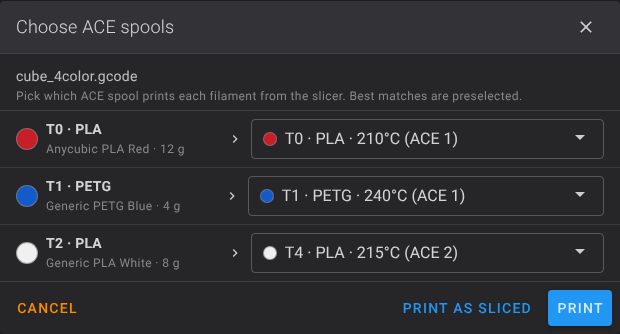
<br>
<em>Left: the window that opens on Print. Right: the card shows the active map (Spools: T1→T3, T2→T4).</em>
</div>

Example line that Orca inserts before the start G-code:

```gcode
; ACE Spool Mapper: T0 as sliced, T1->T4 PLA, T3->T1 PETG
ACE_SET_TOOL_MAP MAP=1:4,3:1 FILE="benchy.gcode" KEEP_EXISTING=1
```

The slicer preset name of a slot can be stored with `ACE_SET_SLOT … FILAMENT_SETTINGS_ID="<preset>"`. It shows in the slot status and in Moonraker `lane_data`.

---

## 7. Fluidd ACE panel

A build of Fluidd v1.37.7 with an ACE Pro card on the dashboard, a full ACE page (**ACE Pro** in the side menu, or `#/ace`) and a **Choose ACE spools** window at print start.

<div align="center">

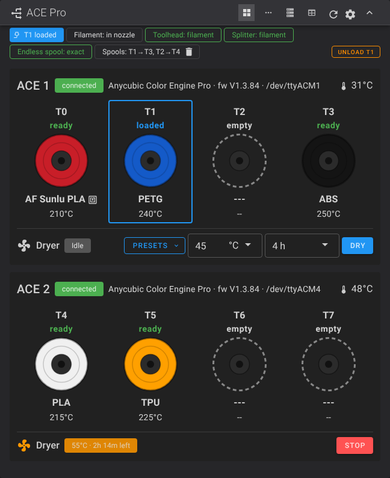<br>
<em>Left: the card with two units. Right: the progress bar during a tool change (demo data).</em>
</div>

### What it does

| Feature | Details |
|---|---|
| **Four layouts** | Switch in the card header: **Cards** (every slot as a spool), **Compact strip** (one row of dots, click one for details), **Spool rack** (rows with the feed tube drawn) and **Table**. The choice is remembered. |
| **Slots** | Colour, material, temperature, RFID mark, load/unload, feed and retract, edit, mark empty. |
| **Slot window** | Material, print temperature, colour, an optional slicer preset name (sent to OrcaSlicer), and the endless spool order for that tool. |
| **Tool-change progress** | While `T<n>` runs the card shows from/to tool and the stage: retract and cut, unload, load, purge and wipe. |
| **Dryer** | Start and stop per unit, with presets by material (PLA, PETG, ABS, TPU…). |
| **Endless spool** | On/off, match mode, and a per-tool order ("take over with T4, then T5"). The order is used first; the match mode applies when none of them is ready. |
| **Cutter wizard** | **Cutter calibration…** in the cog menu walks through finding `cut_full_x` and shows the lever position live ([section 9](#9-calibrate-the-filament-cutter)). |
| **Health and counters** | Connection, firmware, port and chamber temperature per unit, plus tool changes, filament cuts and purged filament. Counters can be reset. |
| **Quick actions** | ACE on/off, RFID sync, smart load/unload, reconnect units, unload all, test the cutter. |

<div align="center">
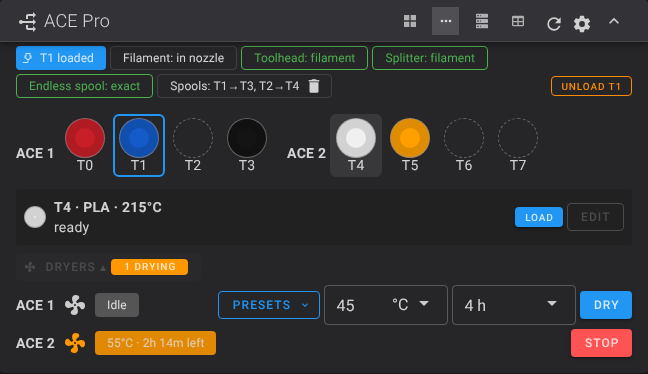
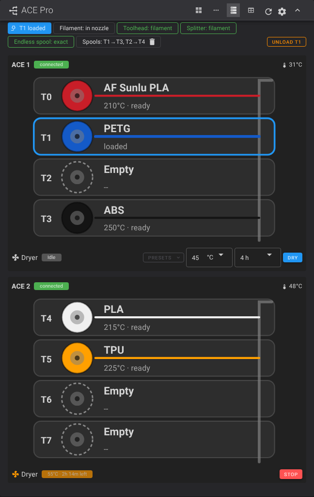<br>
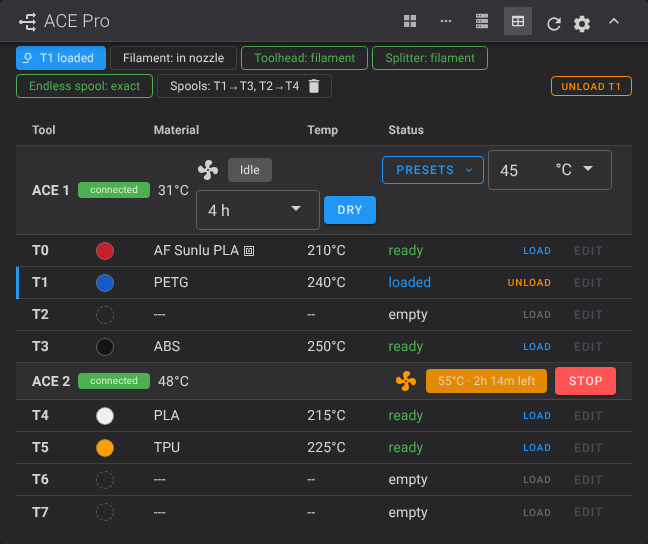
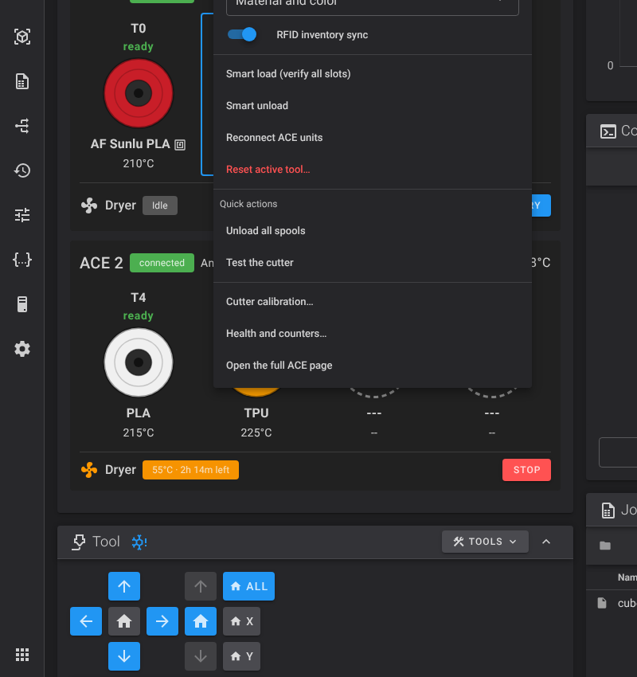<br>
<em>Compact strip (with a slot selected and the dryers open), spool rack, table, and the cog menu.</em>
</div>

<div align="center">
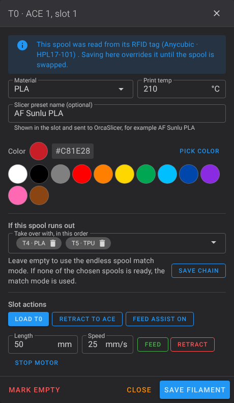
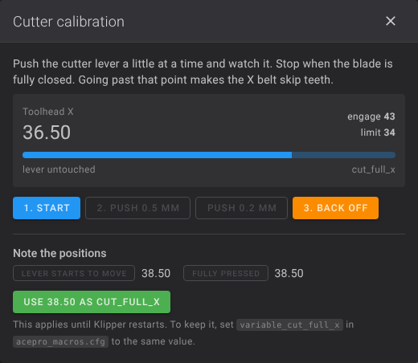
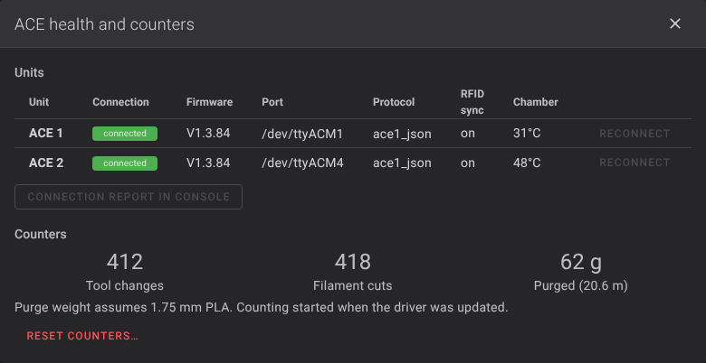<br>
<em>Slot window with the endless spool order, the cutter wizard, and health and counters.</em>
</div>

### Choose ACE spools window

Press **Print** (file browser) or **Re-print** and this window opens. It sends `ACE_SET_TOOL_MAP` and then starts the print.

- **Auto-match** picks the spool whose **colour is closest** to the sliced colour first. The filament type only decides between spools of about the same colour. A spool is never used for two filaments if another fits.
- **List** and **Map** views. The map draws a line from each sliced filament to its spool; dotted lines need a look.
- **Warnings** when the type differs (sliced for PETG, spool is ABS), the colour is far off, the same spool is used twice, or the spool is empty.
- Drag the handle on a row to swap two spools. The purge estimate shows how much filament the tool changes will use.
- **Saved mappings** keep a choice by name so you can reuse it.
- **Dry spools first…** starts the dryer with a preset for the spools you picked.
- **Print as sliced** skips the mapping.

<div align="center">
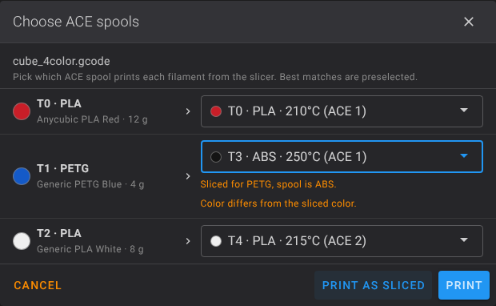
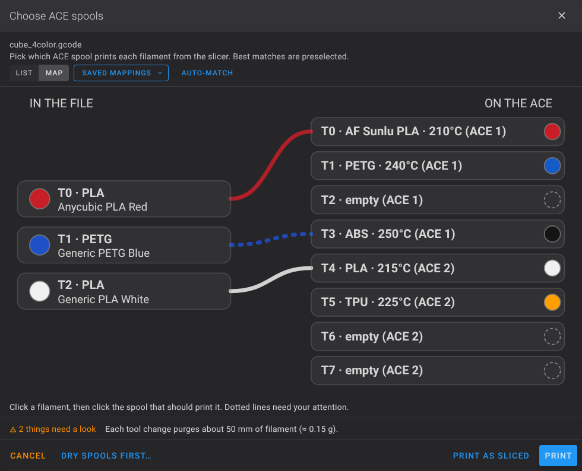<br>
<em>Warnings after choosing an ABS spool for a PETG filament, and the map view.</em>
</div>

<div align="center">
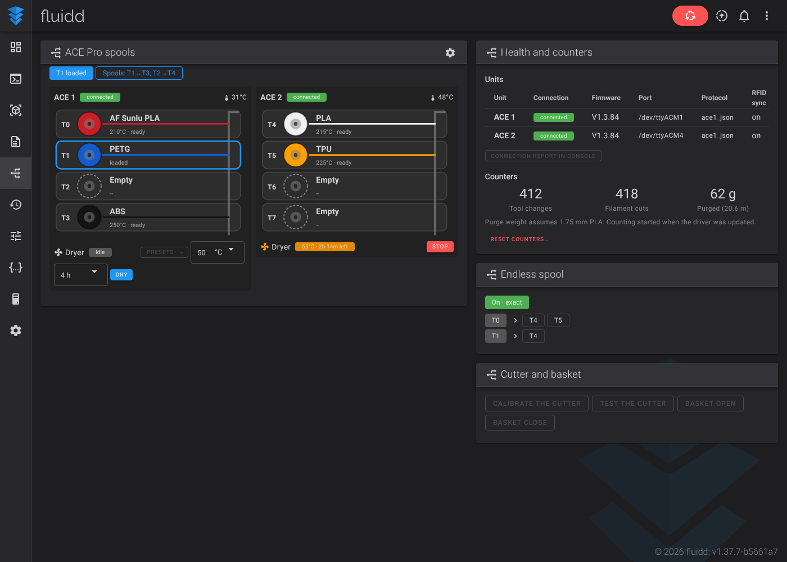<br>
<em>The full ACE page: spools, health and counters, endless spool order, cutter and basket tests.</em>
</div>

### Install the ready-made build

```bash
cd ~/acepro-any-klipper/fluidd
sha256sum -c fluidd-v1.37.7-acepro.zip.sha256          # optional: check the download

mv ~/fluidd ~/fluidd_backup                            # keep your current Fluidd
mkdir ~/fluidd
unzip fluidd-v1.37.7-acepro.zip -d ~/fluidd
cp ~/fluidd_backup/config.json ~/fluidd/ 2>/dev/null   # keep your Fluidd settings
```

Hard-refresh the browser. If the card is missing, open the dashboard layout editor and add **ACE Pro**.

The card expects the switches `[output_pin endless_spool]` and `[output_pin ACE_Pro]`, which `acepro_setting.cfg` defines.

The counters and endless spool order need the updated driver and `acepro.cfg` from this repo (`CUT_TIP` calls `ACE_COUNT_CUT`). Without them the panel still works, but those two parts stay empty.

### Build it yourself

```bash
git clone --branch v1.37.7 https://github.com/fluidd-core/fluidd
cd fluidd && git apply ../acepro-any-klipper/fluidd/fluidd-acepro.patch
pnpm install && pnpm run build        # output in dist/
```

Details: [`fluidd/README.md`](fluidd/README.md).

> Updating Fluidd from Moonraker's update manager replaces this build. Re-install the zip afterwards, or remove Fluidd from the update manager.

---

## 8. KlipperScreen panel

The installer links the panel for you. Manual install:

```bash
ln -sf ~/acepro-any-klipper/KlipperScreen/acepro.py ~/KlipperScreen/panels/acepro.py
```

Add the menu entries to `KlipperScreen.conf` (above the auto-generated block):

```ini
[menu __main acepro]
name: ACE Pro
icon: settings
panel: acepro

[menu __print acepro]
name: ACE Pro
icon: settings
panel: acepro
```

Restart it: `sudo systemctl restart KlipperScreen`.

The panel offers endless spool and match mode, unit cycling, slot material/colour/temperature, load/unload, feed assist, RFID sync and the dryer.

On a 1024×600 screen, use `font_size = small` (the installer sets it). If a layout is cut off, reduce the font or open an issue.

---

## 9. Calibrate the filament cutter

<div align="center">
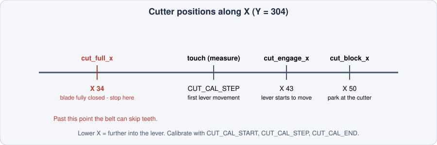
</div>

If the toolhead pushes the cutter lever too far, the X belt can skip teeth. `cut_full_x` is the position where the blade is closed. Going past it is what hurts the belt.

1. Add the calibration macros to `printer.cfg`:
   ```ini
   [include cut_calibrate.cfg]
   ```
   Restart Klipper.
2. Run `CUT_CAL_START`. It homes X/Y, moves to the cutter and stops at `cut_engage_x`.
3. Run `CUT_CAL_STEP` repeatedly (`STEP=0.2` for finer steps). Each call pushes the lever one step and prints the X value.
4. Watch the lever. Note the X where it **starts to move** (touch) and where it is **fully pressed** (bottom).
5. Run `CUT_CAL_END` to back off.
6. Set `cut_full_x` in `_ACE_VARS` to the **bottom** value (mine is `33`), not further. The macro never steps past `cut_full_x`.
7. Test with `CUT_TIP` and listen for belt noise.

The cut itself does a pre-cut retract (`pre_cut_retract_length`, 2 mm, done in relative mode so it is safe with absolute-extrusion files), then cuts `cut_repetitions` times with a `cut_pause_ms` pause at the end of each stroke.

---

## 10. Everyday use and commands

`T0`…`T7` do a full tool change. Useful console commands:

| Command | Description |
|---|---|
| `ACE_GET_STATUS` | Status of all units (temperature, slots, dryer) |
| `ACE_SELFTEST` | Read-only health check of the install. Nothing moves. |
| `ACE_SETUP_CUTTER` / `ACE_SETUP_BUCKET` | Position wizard (section 4.3). Then `ACE_SETUP_SAVE POINT=<name>` and `ACE_SETUP_CONFIRM`. |
| `ACE_QUERY_SLOTS` | Every slot with material and colour |
| `ACE_CHANGE_TOOL TOOL=<n>` | Change to tool *n* (`-1` unloads) |
| `ACE_SET_SLOT …` | Set a slot's material, colour, temperature and preset name |
| `ACE_FEED T=<n> LENGTH=<mm>` / `ACE_RETRACT …` | Move filament from one slot |
| `ACE_SMART_LOAD` / `ACE_SMART_UNLOAD` | Guided load / unload |
| `ACE_FULL_UNLOAD` | Unload everything |
| `ACE_START_DRYING` / `ACE_STOP_DRYING` | Dryer |
| `ACE_CHECK_TOOL TOOL=<n>` | Check that a tool is ready |
| `ACE_CHECK_PRINT_TOOLS` | Check every tool the current file needs |
| `ACE_ENABLE_ENDLESS_SPOOL` / `ACE_DISABLE_ENDLESS_SPOOL` | Endless spool on/off |
| `ACE_SET_ENDLESS_SPOOL_MODE MODE=exact\|material\|next` | Match mode |
| `ACE_TANGLE_DETECTION ENABLE=0\|1` | Tangle detection (off by default) |
| `ACE_RECONNECT` / `ACE_REDETECT` | Reconnect or rescan the units |
| `ACE_GET_CONNECTION_STATUS` | Connection stability per unit |
| `ACE_DEBUG_SENSORS` | Show sensor states |
| `ACE_SET_ENDLESS_CHAIN` / `ACE_GET_ENDLESS_CHAIN` | Endless spool takeover order per tool (section 11) |
| `ACE_RESET_STATS [WHAT=cuts\|tool_changes\|purge_mm]` | Reset the counters shown in Fluidd |
| `CUT_TIP`, `FLUSH_POOP`, `SERVO_TEST ANGLE=90` | Hardware tests |

All commands with examples: [`example_cmds.txt`](example_cmds.txt). Architecture: [`ARCHITECTURE.md`](ARCHITECTURE.md). Serial protocol: [`PROTOCOL.md`](PROTOCOL.md).

### Starting a print

`MY_START_PRINT` checks if the requested tool is already at the nozzle and skips the reload if so. If the ACE is switched off (`ACE_Pro` switch in Fluidd), it passes straight through to `START_PRINT`.

### Pause, resume and cancel

- `PAUSE` parks the toolhead, retracts, drops the bed if needed and starts a nozzle timeout.
- `RESUME` reloads the right spool. If a tool change failed half-way, it reloads the tool that was being loaded.
- A filament runout at the nozzle pauses the print with a prompt. Insert filament into the toolhead and it is pulled in.

---

## 11. Endless spool

When a runout is detected, the driver finds a compatible spool and switches to it. Turn it on from the Fluidd card, KlipperScreen, or the console.

| Mode | Matches |
|---|---|
| `exact` (default) | Same material **and** colour |
| `material` | Same material, any colour |
| `next` | First ready spool in order |

Spools with no material label are `Unknown` and **never** match each other. Label spools with `ACE_SET_SLOT` for safe endless spool.

### Takeover order per tool

You can also say exactly which spools take over, in order. The order is tried first; if none of them is ready, the match mode above applies.

| Command | What it does |
|---|---|
| `ACE_SET_ENDLESS_CHAIN TOOL=0 NEXT=4,5` | When T0 runs out, use T4, then T5 |
| `ACE_SET_ENDLESS_CHAIN TOOL=0 NEXT=` | Remove the order for T0 |
| `ACE_GET_ENDLESS_CHAIN` | Show all orders |
| `ACE_CLEAR_ENDLESS_CHAIN [TOOL=<n>]` | Remove all orders, or one |

Orders are saved and also set from the slot window in Fluidd.

---

## 12. Connection supervision

The driver watches how stable the USB link is. Six or more reconnects in three minutes pauses the print. It is on by default:

```ini
[ace]
ace_connection_supervision: False      # to turn it off
```

More: [`CONNECTION_SUPERVISION.md`](CONNECTION_SUPERVISION.md).

---

## 13. Update and undo

### Update from GitHub

Run this on the Pi (over SSH) to bring the newest version to your printer:

```bash
cd ~/acepro-any-klipper
git pull
./installer.sh --update
```

- `git pull` downloads the new files into the folder. Nothing in your printer config changes yet.
- `./installer.sh --update` installs them, keeps your settings, saves a backup first, and restarts Klipper if you say yes.
- Check what you have with `cat VERSION` (it prints the version; an older download has no `VERSION` file).
- Not sure it worked? `./installer.sh --check` looks for problems and changes nothing.

**`git pull` says "Your local changes would be overwritten"?** You edited a file inside the `acepro-any-klipper` folder itself (not in `printer_data/config`). Keep your edit aside and pull:

```bash
git stash
git pull
git stash pop      # put your edit back (skip this if you do not need it)
```

**The folder is damaged or you want a clean copy?** Move it away and clone again. Your printer config is not in this folder, so it is not affected:

```bash
cd ~
mv acepro-any-klipper acepro-any-klipper.old
git clone -b dev https://github.com/ducati1198/acepro-any-klipper
cd acepro-any-klipper && ./installer.sh --update
```

`--update` takes the new code and keeps your values: positions, speeds, sensor pins, the servo pin and which optional parts you left out. It also moves a `[servo servo_wipe]` section or `PAUSE` / `RESUME` from an older single-file install into the new files. If you edited the *code* of a macro (not just its values), that edit is not carried over; your old file is in the backup. The installer tells you when a newer version is on GitHub.

### Fluidd macro category

The installer puts the ACE macros into their own Fluidd category, **ACEPRO MACRO**, coloured hot pink (`#ff00aa`), so they are easy to find. Macros you already sorted into another category stay there; macros whose names start with `_` are hidden by Fluidd anyway. It is a display setting kept in Moonraker's database, so no config file changes. The old settings are saved first, `--uninstall` removes the category (its macros go back to Uncategorized), and `--undo` puts the old settings back. If Moonraker cannot be reached the step is skipped.

### Software Updates and "what changed"

The installer adds `[update_manager acepro]` to `moonraker.conf` (saved first), so the repo shows up in Fluidd's Software Updates page and you can pull new driver code there. On Simple AF it asks first, because Simple AF may overwrite `moonraker.conf`. The page only downloads code; run `./installer.sh --update` afterwards to refresh the config files. After `--update` the installer prints the `CHANGELOG.md` entries newer than the version you had.

### Undo

Every install and update first saves what it will change in `~/acepro-backup/<date>/`. To put it back:

```bash
./installer.sh --undo            # the latest backup
./installer.sh --undo ~/acepro-backup/20261102_103000   # a specific one
```

It restores changed files, removes files the install added, and puts links back as they were.

### Uninstall

```bash
./installer.sh --uninstall
```

Shows what it will remove, asks, saves everything first, then removes: the ACE config files, the driver links, the KlipperScreen link and menu entries, the `[include acepro.cfg]` line, and the ACE lines it added to `my_saf_hooks.cfg` (your own lines stay; a hooks file that held only ACE lines is deleted with its include). It leaves alone `[force_move]`, `[virtual_pins]`, the Fluidd ACE panel and Python packages. `./installer.sh --undo` brings it all back.

### Doctor

```bash
./installer.sh --doctor            # add --dry-run to only look
```

Checks the includes, the driver links, lines below the SAVE_CONFIG block, virtual-pin order, macros defined in several files, and the config check. For each problem it explains why it matters and offers a fix; it changes nothing unless you say yes, and saves first. Macros defined in several files are only explained: the file loaded last wins.

### Values from an earlier install

On a fresh install the installer looks for earlier ACE settings (the current config, installer backups, `~/acepro-removed-*` folders), shows what differs from the defaults, and asks which one to copy your values (positions, cutter speeds) from, or none.

### What changed in the latest sync

The driver, KlipperScreen panel and Moonraker plugin follow [Kobra-S1/ACEPRO](https://github.com/Kobra-S1/ACEPRO) (29 Oct 2026, `04d454f`). Highlights since May:

- Heater stays on during tool changes; recovery after a failed load; a failed `T<n>` stops the macro.
- Emergency stop also stops ACE feed assist and moves.
- A corrupt serial frame no longer stalls replies; better multi-unit discovery.
- `ACE_FULL_UNLOAD` no longer clears the loaded tool when unloading another slot.
- KlipperScreen: wrong temperature with more than one ACE fixed; scroll and small-screen fixes.
- Two macro fixes: the pre-cut retract runs in relative mode, and `RESUME` reloads the tool of an unfinished change.

Added in this fork: spool mapping (`tool_map.py`), the preset name in `ACE_SET_SLOT` and `lane_data`, the Fluidd panel (layouts, progress, dryer presets, counters, cutter wizard), endless spool order per tool, usage counters (`ACE_COUNT_CUT` in `CUT_TIP`), the Orca plugin and the cutter calibration.

> If you update `acepro.cfg` by hand, add `ACE_COUNT_CUT` to `CUT_TIP` just before `RESTORE_GCODE_STATE NAME=cut_tip_state`, or the cut counter stays at zero.

Behaviour changes to know: `feed_assist_off_when_idle` and `stop_ace_on_shutdown` now default to **on**. Add `feed_assist_off_when_idle: False` to `[ace]` for the old behaviour.

### Run the tests

```bash
cd ~/acepro-any-klipper
pip install -r requirements.txt pytest
pytest
```

---

## 14. Troubleshooting

| Symptom | Fix |
|---|---|
| `Internal error during connect: 'NoneType' object has no attribute 'send'` | Klipper cannot reach an MCU over USB. See "Raspberry Pi 5 + USB HAT" below. |
| The installer says a pin is not valid | Use the pin name from your `printer.cfg`, for example `PA4`, `nozzle_mcu:PA8` or `^PC15`. |
| Cutter, poop or wipe moves stop with "positions not confirmed" | Measure them (section 4.3), then set `variable_positions_confirmed: True` in `_ACE_VARS`. |
| The ACE pause steps do not run (Klipper / Kalico) | Another file defines `PAUSE` / `RESUME` and loads after `[include acepro.cfg]`. Move the ACE include below it. `./installer.sh --check` shows files that define the same macro. |
| Links in `klippy/extras` missing after a Simple AF or Fluidd update | `./installer.sh --repair` |
| ACE not found | Check `ls /dev/serial/by-id/`. Run `ACE_REDETECT`. Check the USB cable and the ACE power supply. |
| `UNSOLICITED` messages in the console | Normal after a reconnect (old replies are discarded). If frequent, check the cable and power. |
| `High-priority queue full` | Transient. Restart Klipper or power-cycle the ACE if it persists. |
| Spool does not wind tightly on retract | Lower `retract_speed` (try 30). |
| Tool change fails with "path blocked" | `ACE_DEBUG_SENSORS`. Clear the toolhead sensor, then `ACE_CHANGE_TOOL TOOL=-1`. |
| Belt skips teeth at the cutter | The lever is pushed too far. Recalibrate `cut_full_x` (section 9). |
| Fluidd shows no ACE card or old panel | Hard-refresh the browser. Check that the zip was unpacked into `~/fluidd`. |
| Orca plugin asks for permission at print start | Accept once; the grant is remembered for that host. |
| Orca plugin shows an old version | Delete the old plugin in **File → Plugins** and install again. |
| Orca shows no ACE Spools panel | **File → Plugins** → ACE Spool Mapper → open **ACE Spools**. Sending a print never opens windows. |

### Raspberry Pi 5 + USB HAT (Waveshare PCIe → USB HAT+)

On a Pi 5 the newer 6.12.x kernels fail to start the HAT's USB controller (`xhci_hcd ... can't setup: -12`, tracked upstream as [raspberrypi/linux #7715](https://github.com/raspberrypi/linux/issues/7715), still open when this was written). Klipper then cannot find the ACE units, the toolhead MCU or the expander board, and fails with the `'NoneType'` error above. A fresh Raspberry Pi OS install gets the newest kernel, so it hits this straight away. Reported broken: 6.12.109. Reported working: 6.12.75 (upstream report) and 6.12.96 (my printer).

**Fix: stay on a working kernel.** One command does it (the installer offers it too when it sees the error):

```bash
sudo bash tools/pin-pi5-kernel.sh --check     # look only: kernel, xhci errors, installed kernels
sudo bash tools/pin-pi5-kernel.sh             # install and pin 6.12.96 (or: --kernel 6.12.75)
sudo reboot
```

It installs the older kernel package if needed, copies its kernel and initramfs next to `config.txt`, points `config.txt` at them for the Pi 5 only, runs `sync` (an unflushed write to the FAT boot partition is lost on reboot), and holds the kernel meta packages so `apt upgrade` does not move you forward. After the reboot check `uname -r` and `dmesg | grep -i xhci`.

If apt does not offer that version any more, the script lists what it does offer; pick one with `--kernel`.

When a fixed kernel is released, undo it with `sudo bash tools/pin-pi5-kernel.sh --unpin` and reboot.

If your ACE and MCUs disappear after an OS update, check `dmesg | grep -i xhci` first.

---

## 15. CFS purge chute variant (K1 Max, untested)

For a K1 Max with the factory **CFS purge chute** (no servo bucket) there is a separate, optional set of files in [`variants/cfs-chute/`](variants/cfs-chute/). It is not installed or changed by `installer.sh`, and nothing in `config/` depends on it.

> **⚠️ Untested, use at your own risk.** It has **not been tested on any K1 series printer**: the author does not own the CFS purchase, its extruder or the cutter block. It has not been run through the installer either. The author and contributors are **not responsible for any damage** to your printer or anything else, or for any injury or loss, caused by these files; there is no warranty.
>
> **Caution:** check **your own printer's specs** (axis limits, where the chute, flap and cutter block really are, sensor pins) before running anything, and **test in small steps**: slowly, nozzle cold, no filament, hand on the power switch. A wrong position can crash the toolhead.

What it does: after the cut the head approaches the chute from Y287 and creeps in, purges, retracts 2 mm, shakes the chute (`HIT_PURGE_CHUTE`), wipes the nozzle on the silicone flap (`WIPE_ON_CHUTE_FLAP`), then backs out slowly. Its numbers come from the author's own configuration and from [swilsonnc/ACEPROK1Max](https://github.com/swilsonnc/ACEPROK1Max), and have not been verified on a real CFS chute.

- **Use it instead of** `acepro.cfg`: change `[include acepro.cfg]` to `[include cfs_acepro.cfg]` in `printer.cfg`. Never include both.
- **Positions start locked** (`variable_positions_confirmed: False`). Every number is a K1 Max number. A K1 or K1C has a smaller bed and cannot reach them: measure everything yourself.
- It is an older base than `config/`: no Simple AF pause/resume switch, no hooks file, no hardware switches.
- After switching, `./installer.sh --repair` and `--doctor` will offer to add `[include acepro.cfg]` back. Say no.

Full details, the position table, a first-run checklist and notes: [`variants/cfs-chute/README.md`](variants/cfs-chute/README.md).

---

## 16. Repository layout

```
acepro-any-klipper/
├── installer.sh                  Installer (install, --update, --check, --repair, --undo, --dry-run, --support-bundle)
├── VERSION, CHANGELOG.md         Version and what changed
├── extras/ace/                   Klipper driver (linked into klippy/extras)
│   ├── manager.py, commands.py   Tool changes and G-code commands
│   ├── tool_map.py               Spool mapping at print start
│   ├── endless_spool.py          Runout handling
│   └── moonraker_lane_sync.py    Orca lane_data sync
├── config/                       Shared core configs (every profile)
│   ├── acepro.cfg                Sensors, CUT_TIP, poop, wipe, servo
│   ├── acepro_setting.cfg        [ace] settings and virtual switches
│   ├── acepro_macros.cfg         _ACE_VARS positions and tool-change macros
│   ├── acepro_printer_macros.cfg PAUSE / RESUME, LOAD/UNLOAD, PARK_FOR_CANCEL, MY_START_PRINT
│   ├── cut_calibrate.cfg         Cutter calibration
│   └── spoolman_logic.cfg        Optional Spoolman helpers
├── profiles/                     What differs per printer software
│   ├── klipper/                  Base profile (no extra files)
│   ├── kalico/                   Same as klipper, plus the heater `control:` check
│   └── saf/                      Simple AF: hooks file, notes (no PAUSE / RESUME)
├── examples/                     Not installed: servo_wiper.cfg, saf_hooks_example.cfg
├── variants/cfs-chute/           Optional, untested: ACE files for a K1 Max with the CFS purge chute (not installed by installer.sh)
├── fluidd/                       Fluidd 1.37.7 build + patch (ACE panel, spool picker)
├── orca_plugin/                  OrcaSlicer 2.5 "ACE Spool Mapper"
├── KlipperScreen/acepro.py       KlipperScreen panel
├── slicer/                       Orca helper scripts
├── tools/ace_console.py          Serial console for debugging
├── tools/validate_config.py      Config check used by the installer
├── tools/ace_cfg_tool.py         Small config editor used by the installer
├── tests/                        Driver tests (pytest) and installer tests (tests/installer/run_tests.sh)
├── docs/HARDWARE.md              Parts, ACE USB adapter wiring, pinouts
├── docs/img/                     Screenshots and diagrams used in this README
```

---

## 17. Credits and license

Built on the work of:

- [Kobra-S1/ACEPRO](https://github.com/Kobra-S1/ACEPRO)
- [szkrisz/ACEPROSV08](https://github.com/szkrisz/ACEPROSV08)
- [utkabobr/DuckACE](https://github.com/utkabobr/DuckACE)
- [agrloki/ValgACE](https://github.com/agrloki/ValgACE)
- [swilsonnc/ACEPROK1Max](https://github.com/swilsonnc/ACEPROK1Max) (the K1 Max with CFS reference used for the chute variant)

Config files organized and maintained by **ducati1198**.

**License:** GNU General Public License v3.0 — see [`LICENSE`](LICENSE).

<div align="center">

**Happy printing!** 🖨️

</div>
