<div align="center">

# ACE Pro for Klipper

**Run an Anycubic ACE Pro multi-material unit (or two, or three) on any Klipper printer.**
Tuned and tested on a **Creality K1 Max** (Raspberry Pi 5, Kalico, Fluidd, KlipperScreen) with two ACE Pro units (T0–T7).

[](https://www.gnu.org/licenses/gpl-3.0)
[](https://www.python.org/)
[](https://www.klipper3d.org/)
[](fluidd/)
[](orca_plugin/)

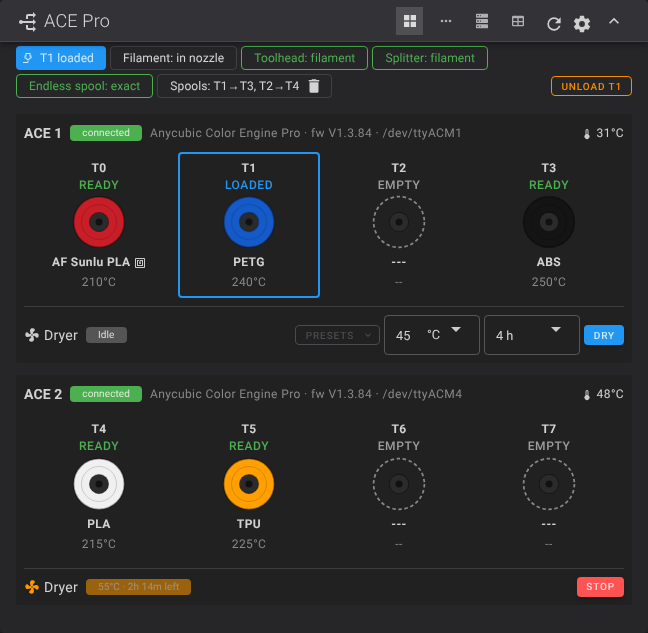

</div>

---

## Contents

1. [What you get](#1-what-you-get)
2. [Hardware and wiring](#2-hardware-and-wiring)
3. [Install](#3-install)
4. [Configure your printer](#4-configure-your-printer)
5. [Slicer setup (OrcaSlicer)](#5-slicer-setup-orcaslicer)
6. [Choose spools at print start](#6-choose-spools-at-print-start)
7. [Fluidd ACE panel](#7-fluidd-ace-panel)
8. [KlipperScreen panel](#8-klipperscreen-panel)
9. [Calibrate the filament cutter](#9-calibrate-the-filament-cutter)
10. [Everyday use and commands](#10-everyday-use-and-commands)
11. [Endless spool](#11-endless-spool)
12. [Connection supervision](#12-connection-supervision)
13. [Update and undo](#13-update-and-undo)
14. [Troubleshooting](#14-troubleshooting)
15. [Repository layout](#15-repository-layout)
16. [Credits and license](#16-credits-and-license)

---

## 1. What you get

| | |
|---|---|
| **Any Klipper printer** | Not tied to Anycubic hardware. Voron, RatRig, Creality K1 and others work. |
| **1–3 ACE Pro units** | T0–T3, T4–T7, T8–T11. Tested with two units. |
| **Full tool changes** | Retract, cut, unload, load, purge, wipe, all driven by `T0`…`T7`. |
| **Filament cutter** | `CUT_TIP` with a step-by-step calibration (`cut_calibrate.cfg`). |
| **Servo poop basket** | Deploys for heating, purging and wiping, then retracts. |
| **Spool mapping at print start** | Pick which physical spool prints each sliced filament. No re-slicing. |
| **Fluidd panel** | An ACE card with four layouts, a tool-change progress bar, dryer presets, a cutter wizard, counters and a "Choose ACE spools" window at print start ([section 7](#7-fluidd-ace-panel)). |
| **OrcaSlicer plugin** | The same choice inside Orca, written into the G-code when you send it. |
| **KlipperScreen panel** | Slots, load/unload, dryer and endless spool from the touchscreen. |
| **Endless spool** | Switches to a matching spool when one runs out, or to the spools you list for that tool in order. |
| **Counters** | Tool changes, filament cuts and purged filament, shown in Fluidd. |
| **Moonraker `lane_data` sync** | Orca sees the loaded filament types and colours. |
| **RFID sync** | Reads material, colour and temperature from the ACE tags. |
| **Safety** | Connection supervision, runout and tangle handling, recovery after a failed load. |

<div align="center">
<br>
<em>The ACE Pro card on the Fluidd dashboard (demo data).</em>
</div>

---

## 2. Hardware and wiring

What you need, how to connect the ACE Pro by USB, and the machine this repository is tuned on. (The same guide is also in [`docs/HARDWARE.md`](docs/HARDWARE.md).)

> The connector pinouts below come from the Kobra-S1/ACEPRO documentation and community adapter builds. They are not re-measured on every unit, so **check your adapter with a multimeter before plugging it in** (section 2.4).

### 2.1 What you need

| Part | Required | Notes |
|---|---|---|
| 1 to 3 Anycubic Color Engine Pro units | Yes | Tested here with two (T0–T7). |
| USB cable or adapter for each ACE | Yes | Section 2.3 shows how to build one. |
| **Toolhead filament sensor** (close to the hotend) | Yes | Detects runout and tells the driver when filament reaches the nozzle. |
| **RDM sensor** (the splitter or "return module") | Optional | Lets the driver check the path and confirm an unload. |
| **Filament cutter** | Recommended | Gives clean tool changes. This setup uses a mechanical cutter pushed by the toolhead (section 9). |
| Poop bucket and servo basket | Optional | Catches the purge. The servo here is an EZMAX ES3004. |
| Klipper host with free USB ports | Yes | A Pi 5 with a USB HAT works. Use a powered hub if the ports are weak. |

The sensor pins are set in `acepro.cfg` (section 4.2).

### 2.2 Which ACE do you have?

| Unit | What the 4-pin connector carries | What to use |
|---|---|---|
| **ACE Pro** (first generation) | Native USB data | A plain USB-A adapter (below). It appears in Linux as `/dev/ttyACM*`. |
| **ACE 2 Pro** | RS-485, not USB | The RS485-to-USB conversion cable from Anycubic's ACE 2 kit for the KS1 / K3. A home-made USB cable will not work, and the Kobra-X / KS1-Max cable is not the same part. |

The driver detects which protocol a unit speaks (`protocol: auto` in `acepro_setting.cfg`). The rest of this section is about the first-generation ACE Pro, which this setup uses.

### 2.3 USB adapter for the ACE Pro

<div align="center">

</div>

Only **three wires** are used: **D+, D- and GND**. Do **not** connect VBUS (5 V). The ACE has its own power supply, and a second 5 V source on the data cable can damage the Pi or the unit.

The stock cable has a 6-pin plug for the ACE's socket and a 4-pin plug that normally goes into an Anycubic printer. You can adapt either end:

| | Variant A: adapt the printer end | Variant B: adapt the ACE end |
|---|---|---|
| Original cable | Kept as it is | Not used |
| You build | A 4-pin socket to USB-A adapter | A 6-pin plug to USB-A cable |
| Donor part | A 4-pin ACE extension cable (cut one end off) | A 6-pin plug or pigtail |
| Good if | You want to keep the original cable and be able to go back to it | You want the shortest path or a tidy back cover |

<div align="center">

</div>

| ACE signal | USB-A pin |
|---|---|
| D+ | 3 |
| D- | 2 |
| GND | 4 |
| NC (not connected) | 1 (VBUS), left unconnected |

- The plug and the socket faces are mirror images of each other. That is normal for connectors that mate.
- Find each pin by its **position** in the diagram, never by wire colour. Colours differ between cable makers.
- The 6-pin plug has the same 2×2 signal block in two columns, plus a third column with no contacts.

Ready-made options: [printable USB-A adapter](https://www.printables.com/model/1163780-anycubic-ace-pro-usb-a-adapter) and [printable USB-C back cover](https://www.printables.com/model/1227630-anycubic-acepro-back-cover-for-usb-c). Pinout documentation: [Kobra-S1/ACEPRO](https://github.com/Kobra-S1/ACEPRO).

### 2.4 Check before you plug in

With a multimeter (no ACE connected, nothing powered):

1. **Continuity:** D+ to USB pin 3, D- to USB pin 2, GND to USB pin 4.
2. **No shorts:** D+ to D-, D+ to GND and D- to GND must not beep.
3. **VBUS:** USB pin 1 must not be connected to anything on the ACE side.

Then plug it in, power the ACE and, on the Pi:

```bash
ls /dev/serial/by-id/          # the ACE should be listed
```

Restart Klipper and run `ACE_GET_STATUS`.

### 2.5 My setup

This is the machine the configs in [`config/`](config/) are written for. If yours differs, the values in section 4 are the ones to change.

| Part | What I use |
|---|---|
| Printer | Creality K1 Max (CoreXY, TMC2209 sensorless homing) |
| Host | Raspberry Pi 5 with an NVMe drive |
| USB | Waveshare PCIe → M.2 **USB HAT+** (the ACE units, the toolhead MCU and the expander board plug into it) |
| Firmware | Kalico (Klipper fork) + Moonraker |
| Web UI | Fluidd 1.37.7 (with the ACE panel from this repo) |
| Touchscreen | KlipperScreen, 1024×600 |
| ACE | Two ACE Pro units → T0–T3 and T4–T7 |
| Cutter | Mechanical cutter block at the back-left, pushed by the toolhead moving along X |
| Poop basket | EZMAX ES3004 servo on `PB14` |
| Slicer | OrcaSlicer 2.5 on macOS |

<div align="center">
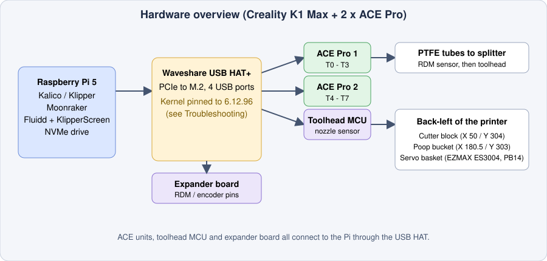
</div>

On a Pi 5 with the Waveshare USB HAT+, a kernel update broke the HAT's USB controller on my printer. See "Raspberry Pi 5 + USB HAT" in section 14.

Important positions in `acepro_macros.cfg`:

| Setting | Value | Meaning |
|---|---|---|
| `cut_block_x / y` | 50 / 304 | Where the cutter sits |
| `cut_engage_x / y` | 43 / 304 | Where the lever starts to move |
| `cut_full_x / y` | **34** / 304 | Where the blade is fully closed (never go past this) |
| `cut_repetitions`, `cut_pause_ms` | 2, 150 | Cutting cycles and pause at the full position |
| `poop_x / y` | 180.5 / 303 | Waste bucket |
| `servo_deploy_angle` | 87° | Basket open |

---

## 3. Install

### 3.1 Requirements

- A Klipper or Kalico printer with Python 3.9+, running Moonraker.
- One to three ACE Pro units connected by USB (a powered hub or HAT is fine).
- SSH access to the Pi.

### 3.2 Driver (one-command installer)

```bash
sudo apt-get update
sudo apt-get install -y git
cd ~
git clone -b dev https://github.com/ducati1198/acepro-any-klipper
cd acepro-any-klipper
chmod +x installer.sh
./installer.sh
```

The installer asks before each step and is safe to run again (it backs up before replacing anything). It will:

1. Link the ACE driver (`extras/ace/`), `virtual_pins` and the ACE temperature sensor into Klipper's `extras` folder.
2. Remove the old ACE web dashboard links, if an earlier install added them (the dashboard is no longer shipped).
3. Check that `pyserial` and `jinja2` are available and that the driver compiles.
4. Install the **Fluidd ACE panel** (ACE card + spool picker): checks the zip, backs up `~/fluidd`, keeps your `config.json`, and restores the backup if the panel isn't found afterwards.
5. Copy `acepro.cfg`, `acepro_printer_macros.cfg`, `acepro_setting.cfg` and `acepro_macros.cfg` into your config folder (existing files are backed up) and add `[include acepro.cfg]` at the top of `printer.cfg`.
6. Copy `cut_calibrate.cfg` and `spoolman_logic.cfg`, add `[force_move]` (needed by `CUT_TIP`) and, if you want, `[include cut_calibrate.cfg]`.
7. Link the **KlipperScreen** panel, add the **ACE Pro** menu entries and set `font_size = small`.
8. Restart Moonraker, Klipper and KlipperScreen, wait for Klipper and tell you whether the ACE driver loaded.
9. Print the steps for the **OrcaSlicer plugin**, which has to be installed on your computer (section 5.3).

### 3.3 Check `printer.cfg`

The installer adds these for you. Check they are there:

```ini
[include acepro.cfg]

[force_move]
enable_force_move: True      # needed by CUT_TIP
```

`[save_variables]` is already created by `acepro_setting.cfg` (it stores inventory and tool state).

Restart Klipper:

```bash
sudo systemctl restart klipper
```

Then run `ACE_GET_STATUS` in the console. You should see every ACE unit connected with its four slots.

### 3.4 Fluidd ACE panel

Installed by the installer (step 4 above). Manual steps and building it yourself: [section 7](#7-fluidd-ace-panel).

### 3.5 OrcaSlicer plugin

Runs on your computer, so the installer can only show the steps. Copy it over and install it from Orca: [section 5.3](#53-ace-spool-mapper-plugin).

> **After any install or update, hard-refresh the browser** so Fluidd loads the new files:
> Windows/Linux `Ctrl+Shift+R` · macOS `Cmd+Shift+R`.

---

## 4. Configure your printer

All settings are commented in the files. The ones to check first:

| File | What it holds |
|---|---|
| `acepro_setting.cfg` | `[ace]` hardware settings: unit count, feed/retract speeds, tube lengths, purge, Moonraker sync. Also the virtual switches `ACE_Pro`, `endless_spool`, `AUTO_UNLOAD`. |
| `acepro_macros.cfg` | `_ACE_VARS`: cutter, poop bucket, wipe, servo and park positions. Tool-change macros. |
| `acepro_printer_macros.cfg` | `PAUSE`, `RESUME`, `LOAD_FILAMENT`, `UNLOAD_FILAMENT` and `MY_START_PRINT`. |
| `acepro.cfg` | Filament sensors, encoder, `CUT_TIP`, poop and wipe moves, servo handling. |
| `cut_calibrate.cfg` | Optional cutter calibration macros (section 9). |

### 4.1 Number of ACE units

```ini
[ace]
ace_count: 2        # T0-T3 on unit 0, T4-T7 on unit 1, T8-T11 on unit 2
```

Per-unit values use the comma syntax, for example `feed_speed: 60,1:45` (unit 0: 60, unit 1: 45).

### 4.2 Filament sensors

The driver uses a nozzle sensor and, optionally, a splitter (RDM) sensor:

```ini
[filament_switch_sensor filament_runout_nozzle]
switch_pin: !nozzle_mcu:PA10        # your own pin
pause_on_runout: True

[filament_switch_sensor filament_runout_rdm]
switch_pin: PC15                    # your own pin
pause_on_runout: False
```

Tell the driver their names in `acepro_setting.cfg`:

```ini
filament_runout_sensor_name_nozzle: filament_runout_nozzle
filament_runout_sensor_name_rdm: filament_runout_rdm
```

`acepro.cfg` also defines an encoder (`filament_motion_sensor ace_encoder`) that pauses if the extruder blocks. Change the pins to match your wiring.

### 4.3 Positions to measure on your printer

Edit these in `_ACE_VARS` (`acepro_macros.cfg`):

- **Cutter:** `cut_block_*`, `cut_engage_*`, `cut_full_*` (use the calibration in section 9).
- **Poop bucket:** `poop_x`, `poop_y`, plus the shake and oscillation values.
- **Wipe:** `wipe_start_x/y`, `wipe_length`, `wipe_pattern` (`STRAIGHT` or `ZIGZAG`).
- **Servo:** pin in `[servo servo_wipe]`, `servo_deploy_angle`, `servo_retract_angle`, `servo_min_z`.

### 4.4 Temperature sensors

`acepro_setting.cfg` already adds a `temperature_ace` sensor per unit (`acepro_temp_1`, `acepro_temp_2`). Add another for a third unit.

---

## 5. Slicer setup (OrcaSlicer)

### 5.1 Machine start G-code

Replace the call to `START_PRINT` with `MY_START_PRINT`. It loads the first tool through the ACE (skipping the reload if that tool is already at the nozzle), heats, cools down to a safe temperature, and then continues into your own `START_PRINT`.

```gcode
M140 S0
M104 S0
MY_START_PRINT TOOL={initial_tool} BED_TEMP=[bed_temperature_initial_layer_single] EXTRUDER_TEMP=[nozzle_temperature_initial_layer]
SET_PRINT_STATS_INFO TOTAL_LAYER=[total_layer_count]
```

**Machine end G-code:** keep your normal `PRINT_END`.

### 5.2 Layer change G-code

```gcode
;AFTER_LAYER_CHANGE
SET_PRINT_STATS_INFO CURRENT_LAYER={layer_num + 1}
M117 Layer {layer_num+1}/[total_layer_count] : {filament_settings_id[0]}
```

Also check:

- **Printer settings → Multimaterial:** enable *Single extruder multi-material* and set the filament count to the number of ACE slots you use.
- **Printer settings → Connection:** host set to your Pi, for example `192.168.1.50:7125` (Moonraker).
- **Flush/purge:** [`slicer/orca_flush_to_purgelength.py`](slicer/orca_flush_to_purgelength.py) converts Orca's flush volumes into purge lengths.

### 5.3 ACE Spool Mapper plugin

The plugin lets you choose the physical spool for each sliced filament inside Orca. Full guide: [`orca_plugin/INSTALL.md`](orca_plugin/INSTALL.md).

<div align="center">

</div>

1. In OrcaSlicer 2.5 or newer open **File → Plugins**.
2. **Browse plugins → Install local plugin** and pick `orca_plugin/ace_spool_mapper.py`.
3. Click **Yes** when Orca asks whether the plugin may connect to your printer.
4. Enable the two parts: **ACE Spools** (the panel) and **ACE Spool Map** (the G-code step).
5. Switch Orca to **Advanced** mode, open **Process → Others → Slicing Pipeline Plugin**, add **ACE Spool Map** and save the process preset. Do this for each process preset you print with.
6. Restart Orca. The **ACE Spools** panel docks beside the 3D view.

Each project filament shows its best match (**Auto →**: same material, closest colour, every spool used once). Change any row, slice, then use **Upload and Print** as usual. A swatch next to each spool shows its colour.

---

## 6. Choose spools at print start

<div align="center">
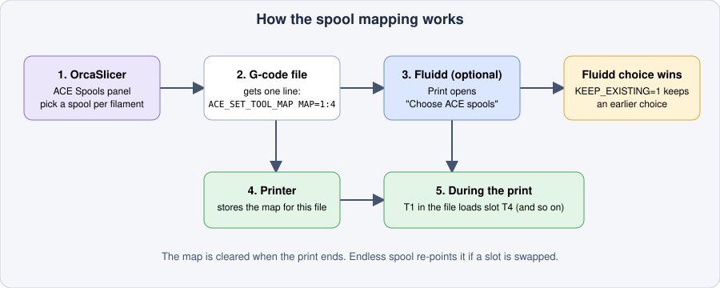
</div>

Print a file with any loaded spools, without re-slicing. The G-code's `T0`, `T1`… are mapped to physical ACE slots **for that one print**.

| Command | What it does |
|---|---|
| `ACE_SET_TOOL_MAP MAP=0:3,2:0 FILE="name.gcode"` | Sliced T0 prints from slot T3, sliced T2 from slot T0 |
| `ACE_SET_TOOL_MAP … KEEP_EXISTING=1` | Does nothing if a choice was already made for this file |
| `ACE_GET_TOOL_MAP` | Shows the active map |
| `ACE_CLEAR_TOOL_MAP` | Clears it |

Rules:

- Only `T<n>` is remapped. `ACE_CHANGE_TOOL` is not, so `RESUME` reloads the real spool.
- The map only applies while that file prints and is cleared when the print ends.
- Endless spool re-points the map when it switches to another slot.
- The status is in the `ace` object: `tool_map`, `tool_map_file`, `tool_map_active`.

Three ways to set it, in order of convenience:

| Where | How |
|---|---|
| **OrcaSlicer** | The ACE Spools panel (section 5.3). The line is written into the G-code you send. |
| **Fluidd** | Press **Print** (or **Re-print**) on a file and the **Choose ACE spools** window opens ([details](#choose-ace-spools-window)). |
| **Console** | `ACE_SET_TOOL_MAP` by hand. |

A choice made later in Fluidd wins over the one from Orca (`KEEP_EXISTING=1`).

<div align="center">
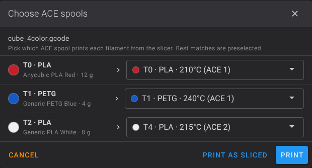
<br>
<em>Left: the window that opens on Print. Right: the card shows the active map (Spools: T1→T3, T2→T4).</em>
</div>

Example line that Orca inserts before the start G-code:

```gcode
; ACE Spool Mapper: T0 as sliced, T1->T4 PLA, T3->T1 PETG
ACE_SET_TOOL_MAP MAP=1:4,3:1 FILE="benchy.gcode" KEEP_EXISTING=1
```

The slicer preset name of a slot can be stored with `ACE_SET_SLOT … FILAMENT_SETTINGS_ID="<preset>"`. It shows in the slot status and in Moonraker `lane_data`.

---

## 7. Fluidd ACE panel

A build of Fluidd v1.37.7 with an ACE Pro card on the dashboard, a full ACE page (**ACE Pro** in the side menu, or `#/ace`) and a **Choose ACE spools** window at print start.

<div align="center">

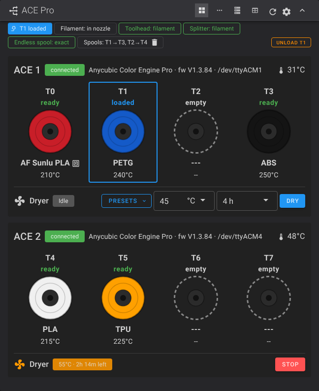<br>
<em>Left: the card with two units. Right: the progress bar during a tool change (demo data).</em>
</div>

### What it does

| Feature | Details |
|---|---|
| **Four layouts** | Switch in the card header: **Cards** (every slot as a spool), **Compact strip** (one row of dots, click one for details), **Spool rack** (rows with the feed tube drawn) and **Table**. The choice is remembered. |
| **Slots** | Colour, material, temperature, RFID mark, load/unload, feed and retract, edit, mark empty. |
| **Slot window** | Material, print temperature, colour, an optional slicer preset name (sent to OrcaSlicer), and the endless spool order for that tool. |
| **Tool-change progress** | While `T<n>` runs the card shows from/to tool and the stage: retract and cut, unload, load, purge and wipe. |
| **Dryer** | Start and stop per unit, with presets by material (PLA, PETG, ABS, TPU…). |
| **Endless spool** | On/off, match mode, and a per-tool order ("take over with T4, then T5"). The order is used first; the match mode applies when none of them is ready. |
| **Cutter wizard** | **Cutter calibration…** in the cog menu walks through finding `cut_full_x` and shows the lever position live ([section 9](#9-calibrate-the-filament-cutter)). |
| **Health and counters** | Connection, firmware, port and chamber temperature per unit, plus tool changes, filament cuts and purged filament. Counters can be reset. |
| **Quick actions** | ACE on/off, RFID sync, smart load/unload, reconnect units, unload all, test the cutter. |

<div align="center">
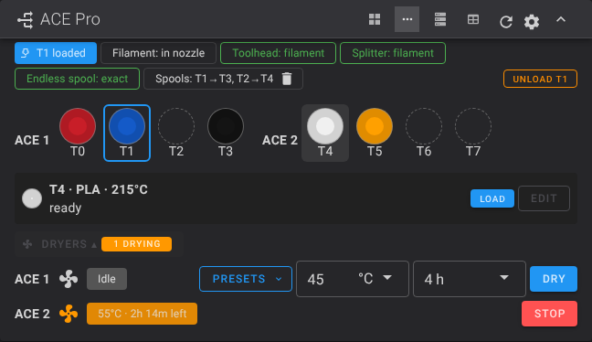
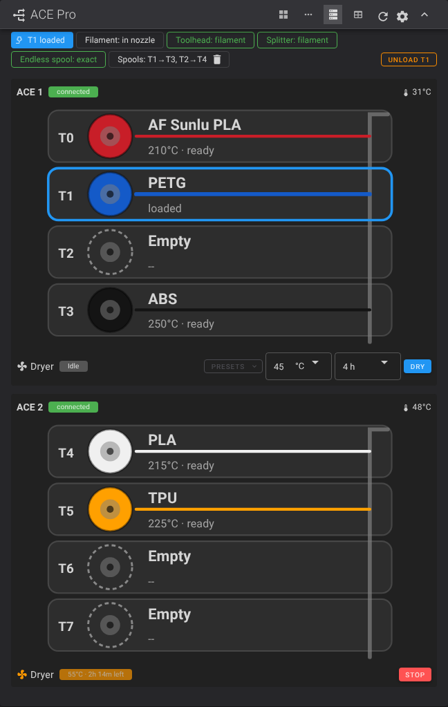<br>
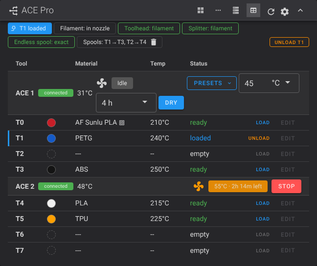
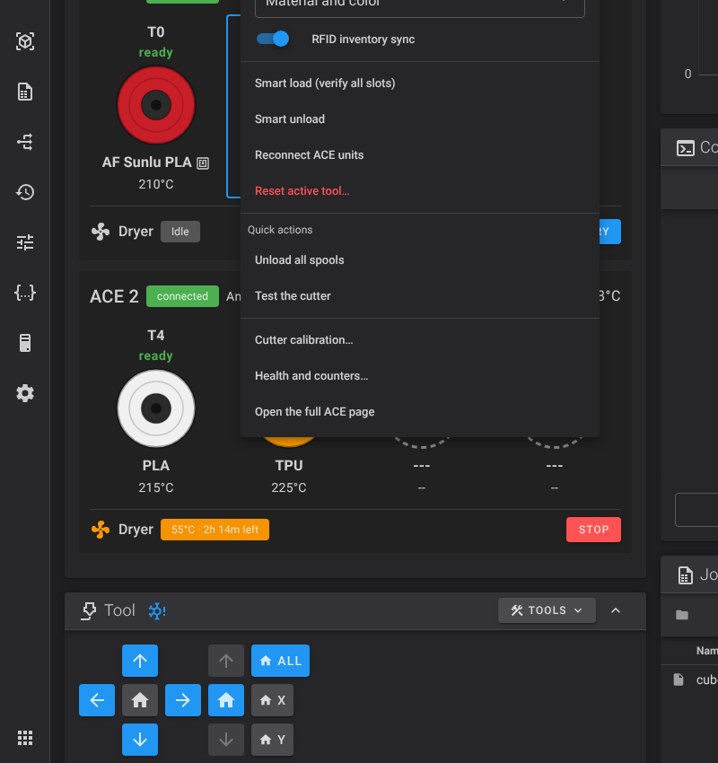<br>
<em>Compact strip (with a slot selected and the dryers open), spool rack, table, and the cog menu.</em>
</div>

<div align="center">
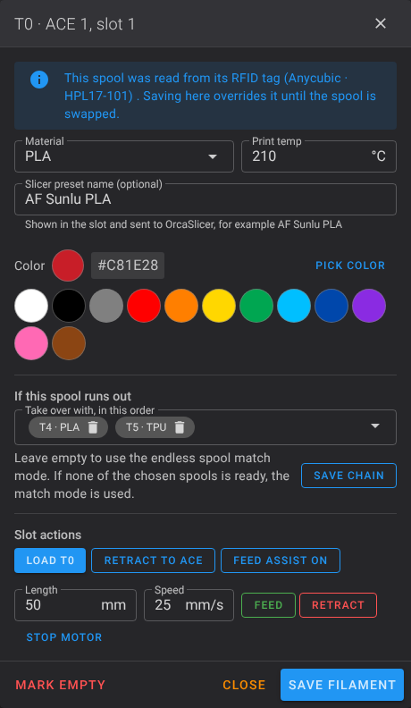
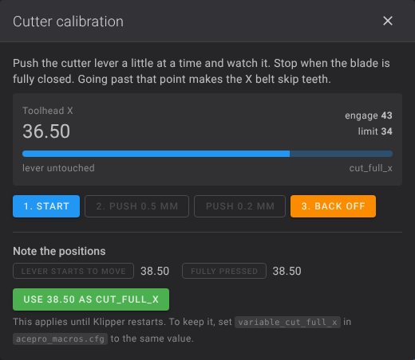
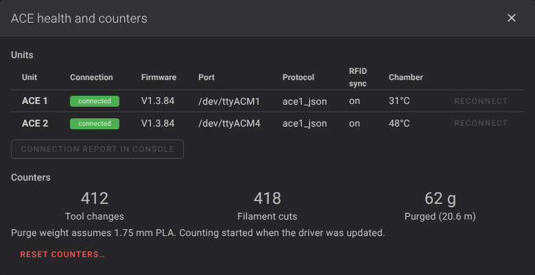<br>
<em>Slot window with the endless spool order, the cutter wizard, and health and counters.</em>
</div>

### Choose ACE spools window

Press **Print** (file browser) or **Re-print** and this window opens. It sends `ACE_SET_TOOL_MAP` and then starts the print.

- **Auto-match** picks the spool whose **colour is closest** to the sliced colour first. The filament type only decides between spools of about the same colour. A spool is never used for two filaments if another fits.
- **List** and **Map** views. The map draws a line from each sliced filament to its spool; dotted lines need a look.
- **Warnings** when the type differs (sliced for PETG, spool is ABS), the colour is far off, the same spool is used twice, or the spool is empty.
- Drag the handle on a row to swap two spools. The purge estimate shows how much filament the tool changes will use.
- **Saved mappings** keep a choice by name so you can reuse it.
- **Dry spools first…** starts the dryer with a preset for the spools you picked.
- **Print as sliced** skips the mapping.

<div align="center">
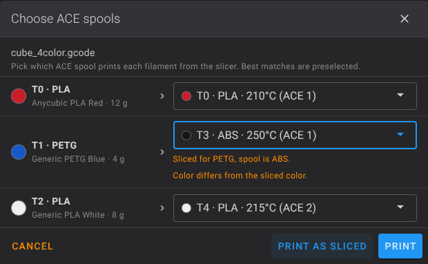
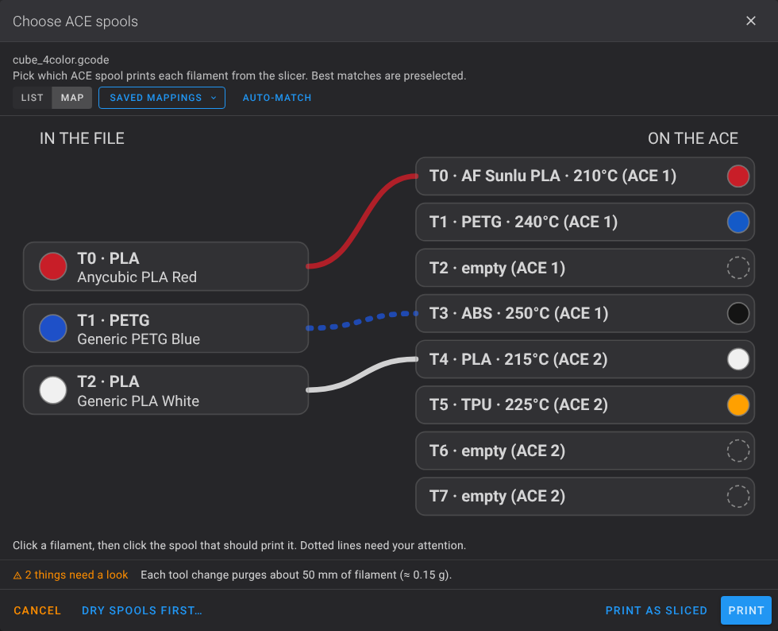<br>
<em>Warnings after choosing an ABS spool for a PETG filament, and the map view.</em>
</div>

<div align="center">
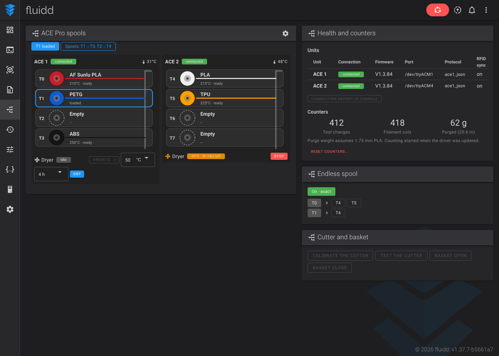<br>
<em>The full ACE page: spools, health and counters, endless spool order, cutter and basket tests.</em>
</div>

### Install the ready-made build

```bash
cd ~/acepro-any-klipper/fluidd
sha256sum -c fluidd-v1.37.7-acepro.zip.sha256          # optional: check the download

mv ~/fluidd ~/fluidd_backup                            # keep your current Fluidd
mkdir ~/fluidd
unzip fluidd-v1.37.7-acepro.zip -d ~/fluidd
cp ~/fluidd_backup/config.json ~/fluidd/ 2>/dev/null   # keep your Fluidd settings
```

Hard-refresh the browser. If the card is missing, open the dashboard layout editor and add **ACE Pro**.

The card expects the switches `[output_pin endless_spool]` and `[output_pin ACE_Pro]`, which `acepro_setting.cfg` defines.

The counters and endless spool order need the updated driver and `acepro.cfg` from this repo (`CUT_TIP` calls `ACE_COUNT_CUT`). Without them the panel still works, but those two parts stay empty.

### Build it yourself

```bash
git clone --branch v1.37.7 https://github.com/fluidd-core/fluidd
cd fluidd && git apply ../acepro-any-klipper/fluidd/fluidd-acepro.patch
pnpm install && pnpm run build        # output in dist/
```

Details: [`fluidd/README.md`](fluidd/README.md).

> Updating Fluidd from Moonraker's update manager replaces this build. Re-install the zip afterwards, or remove Fluidd from the update manager.

---

## 8. KlipperScreen panel

The installer links the panel for you. Manual install:

```bash
ln -sf ~/acepro-any-klipper/KlipperScreen/acepro.py ~/KlipperScreen/panels/acepro.py
```

Add the menu entries to `KlipperScreen.conf` (above the auto-generated block):

```ini
[menu __main acepro]
name: ACE Pro
icon: settings
panel: acepro

[menu __print acepro]
name: ACE Pro
icon: settings
panel: acepro
```

Restart it: `sudo systemctl restart KlipperScreen`.

The panel offers endless spool and match mode, unit cycling, slot material/colour/temperature, load/unload, feed assist, RFID sync and the dryer.

On a 1024×600 screen, use `font_size = small` (the installer sets it). If a layout is cut off, reduce the font or open an issue.

---

## 9. Calibrate the filament cutter

<div align="center">
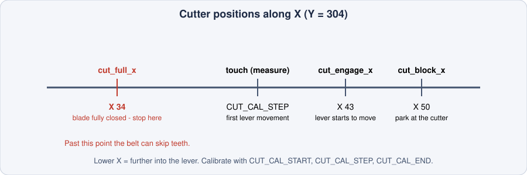
</div>

If the toolhead pushes the cutter lever too far, the X belt can skip teeth. `cut_full_x` is the position where the blade is closed. Going past it is what hurts the belt.

1. Add the calibration macros to `printer.cfg`:
   ```ini
   [include cut_calibrate.cfg]
   ```
   Restart Klipper.
2. Run `CUT_CAL_START`. It homes X/Y, moves to the cutter and stops at `cut_engage_x`.
3. Run `CUT_CAL_STEP` repeatedly (`STEP=0.2` for finer steps). Each call pushes the lever one step and prints the X value.
4. Watch the lever. Note the X where it **starts to move** (touch) and where it is **fully pressed** (bottom).
5. Run `CUT_CAL_END` to back off.
6. Set `cut_full_x` in `_ACE_VARS` to the **bottom** value (mine is `34`), not further. The macro never steps past `cut_full_x`.
7. Test with `CUT_TIP` and listen for belt noise.

The cut itself does a pre-cut retract (`pre_cut_retract_length`, 2 mm, done in relative mode so it is safe with absolute-extrusion files), then cuts `cut_repetitions` times with a `cut_pause_ms` pause at the end of each stroke.

---

## 10. Everyday use and commands

`T0`…`T7` do a full tool change. Useful console commands:

| Command | Description |
|---|---|
| `ACE_GET_STATUS` | Status of all units (temperature, slots, dryer) |
| `ACE_QUERY_SLOTS` | Every slot with material and colour |
| `ACE_CHANGE_TOOL TOOL=<n>` | Change to tool *n* (`-1` unloads) |
| `ACE_SET_SLOT …` | Set a slot's material, colour, temperature and preset name |
| `ACE_FEED T=<n> LENGTH=<mm>` / `ACE_RETRACT …` | Move filament from one slot |
| `ACE_SMART_LOAD` / `ACE_SMART_UNLOAD` | Guided load / unload |
| `ACE_FULL_UNLOAD` | Unload everything |
| `ACE_START_DRYING` / `ACE_STOP_DRYING` | Dryer |
| `ACE_CHECK_TOOL TOOL=<n>` | Check that a tool is ready |
| `ACE_CHECK_PRINT_TOOLS` | Check every tool the current file needs |
| `ACE_ENABLE_ENDLESS_SPOOL` / `ACE_DISABLE_ENDLESS_SPOOL` | Endless spool on/off |
| `ACE_SET_ENDLESS_SPOOL_MODE MODE=exact\|material\|next` | Match mode |
| `ACE_TANGLE_DETECTION ENABLE=0\|1` | Tangle detection (off by default) |
| `ACE_RECONNECT` / `ACE_REDETECT` | Reconnect or rescan the units |
| `ACE_GET_CONNECTION_STATUS` | Connection stability per unit |
| `ACE_DEBUG_SENSORS` | Show sensor states |
| `ACE_SET_ENDLESS_CHAIN` / `ACE_GET_ENDLESS_CHAIN` | Endless spool takeover order per tool (section 11) |
| `ACE_RESET_STATS [WHAT=cuts\|tool_changes\|purge_mm]` | Reset the counters shown in Fluidd |
| `CUT_TIP`, `FLUSH_POOP`, `SERVO_TEST ANGLE=90` | Hardware tests |

All commands with examples: [`example_cmds.txt`](example_cmds.txt). Architecture: [`ARCHITECTURE.md`](ARCHITECTURE.md). Serial protocol: [`PROTOCOL.md`](PROTOCOL.md).

### Starting a print

`MY_START_PRINT` checks if the requested tool is already at the nozzle and skips the reload if so. If the ACE is switched off (`ACE_Pro` switch in Fluidd), it passes straight through to `START_PRINT`.

### Pause, resume and cancel

- `PAUSE` parks the toolhead, retracts, drops the bed if needed and starts a nozzle timeout.
- `RESUME` reloads the right spool. If a tool change failed half-way, it reloads the tool that was being loaded.
- A filament runout at the nozzle pauses the print with a prompt. Insert filament into the toolhead and it is pulled in.

---

## 11. Endless spool

When a runout is detected, the driver finds a compatible spool and switches to it. Turn it on from the Fluidd card, KlipperScreen, or the console.

| Mode | Matches |
|---|---|
| `exact` (default) | Same material **and** colour |
| `material` | Same material, any colour |
| `next` | First ready spool in order |

Spools with no material label are `Unknown` and **never** match each other. Label spools with `ACE_SET_SLOT` for safe endless spool.

### Takeover order per tool

You can also say exactly which spools take over, in order. The order is tried first; if none of them is ready, the match mode above applies.

| Command | What it does |
|---|---|
| `ACE_SET_ENDLESS_CHAIN TOOL=0 NEXT=4,5` | When T0 runs out, use T4, then T5 |
| `ACE_SET_ENDLESS_CHAIN TOOL=0 NEXT=` | Remove the order for T0 |
| `ACE_GET_ENDLESS_CHAIN` | Show all orders |
| `ACE_CLEAR_ENDLESS_CHAIN [TOOL=<n>]` | Remove all orders, or one |

Orders are saved and also set from the slot window in Fluidd.

---

## 12. Connection supervision

The driver watches how stable the USB link is. Six or more reconnects in three minutes pauses the print. It is on by default:

```ini
[ace]
ace_connection_supervision: False      # to turn it off
```

More: [`CONNECTION_SUPERVISION.md`](CONNECTION_SUPERVISION.md).

---

## 13. Update and undo

### Update from GitHub

```bash
rm -rf ~/acepro-any-klipper
cd ~ && git clone -b dev https://github.com/ducati1198/acepro-any-klipper
cd acepro-any-klipper && ./installer.sh
```

Answer **n** when the installer offers to replace config files you edited. Back up your `~/printer_data/config/acepro*.cfg` first. Then restart Klipper, Moonraker and KlipperScreen and hard-refresh the browser.

### What changed in the latest sync

The driver, KlipperScreen panel and Moonraker plugin follow [Kobra-S1/ACEPRO](https://github.com/Kobra-S1/ACEPRO) (29 Oct 2026, `04d454f`). Highlights since May:

- Heater stays on during tool changes; recovery after a failed load; a failed `T<n>` stops the macro.
- Emergency stop also stops ACE feed assist and moves.
- A corrupt serial frame no longer stalls replies; better multi-unit discovery.
- `ACE_FULL_UNLOAD` no longer clears the loaded tool when unloading another slot.
- KlipperScreen: wrong temperature with more than one ACE fixed; scroll and small-screen fixes.
- Two macro fixes: the pre-cut retract runs in relative mode, and `RESUME` reloads the tool of an unfinished change.

Added in this fork: spool mapping (`tool_map.py`), the preset name in `ACE_SET_SLOT` and `lane_data`, the Fluidd panel (layouts, progress, dryer presets, counters, cutter wizard), endless spool order per tool, usage counters (`ACE_COUNT_CUT` in `CUT_TIP`), the Orca plugin and the cutter calibration.

> If you update `acepro.cfg` by hand, add `ACE_COUNT_CUT` to `CUT_TIP` just before `RESTORE_GCODE_STATE NAME=cut_tip_state`, or the cut counter stays at zero.

Behaviour changes to know: `feed_assist_off_when_idle` and `stop_ace_on_shutdown` now default to **on**. Add `feed_assist_off_when_idle: False` to `[ace]` for the old behaviour.

### Run the tests

```bash
cd ~/acepro-any-klipper
pip install -r requirements.txt pytest
pytest
```

---

## 14. Troubleshooting

| Symptom | Fix |
|---|---|
| `Internal error during connect: 'NoneType' object has no attribute 'send'` | Klipper cannot reach an MCU over USB. See "Raspberry Pi 5 + USB HAT" below. |
| ACE not found | Check `ls /dev/serial/by-id/`. Run `ACE_REDETECT`. Check the USB cable and the ACE power supply. |
| `UNSOLICITED` messages in the console | Normal after a reconnect (old replies are discarded). If frequent, check the cable and power. |
| `High-priority queue full` | Transient. Restart Klipper or power-cycle the ACE if it persists. |
| Spool does not wind tightly on retract | Lower `retract_speed` (try 30). |
| Tool change fails with "path blocked" | `ACE_DEBUG_SENSORS`. Clear the toolhead sensor, then `ACE_CHANGE_TOOL TOOL=-1`. |
| Belt skips teeth at the cutter | The lever is pushed too far. Recalibrate `cut_full_x` (section 9). |
| Fluidd shows no ACE card or old panel | Hard-refresh the browser. Check that the zip was unpacked into `~/fluidd`. |
| Orca plugin asks for permission at print start | Accept once; the grant is remembered for that host. |
| Orca plugin shows an old version | Delete the old plugin in **File → Plugins** and install again. |
| Orca shows no ACE Spools panel | **File → Plugins** → ACE Spool Mapper → open **ACE Spools**. Sending a print never opens windows. |

### Raspberry Pi 5 + USB HAT (Waveshare PCIe → USB HAT+)

On a Pi 5 the newer 6.12.x kernels fail to start the HAT's USB controller (`xhci_hcd ... can't setup: -12`, tracked upstream as [raspberrypi/linux #7715](https://github.com/raspberrypi/linux/issues/7715), still open when this was written). Klipper then cannot find the ACE units, the toolhead MCU or the expander board, and fails with the `'NoneType'` error above. A fresh Raspberry Pi OS install gets the newest kernel, so it hits this straight away. Reported broken: 6.12.109. Reported working: 6.12.75 (upstream report) and 6.12.96 (my printer).

**Fix: stay on a working kernel.** One command does it (the installer offers it too when it sees the error):

```bash
sudo bash tools/pin-pi5-kernel.sh --check     # look only: kernel, xhci errors, installed kernels
sudo bash tools/pin-pi5-kernel.sh             # install and pin 6.12.96 (or: --kernel 6.12.75)
sudo reboot
```

It installs the older kernel package if needed, copies its kernel and initramfs next to `config.txt`, points `config.txt` at them for the Pi 5 only, runs `sync` (an unflushed write to the FAT boot partition is lost on reboot), and holds the kernel meta packages so `apt upgrade` does not move you forward. After the reboot check `uname -r` and `dmesg | grep -i xhci`.

If apt does not offer that version any more, the script lists what it does offer; pick one with `--kernel`.

When a fixed kernel is released, undo it with `sudo bash tools/pin-pi5-kernel.sh --unpin` and reboot.

If your ACE and MCUs disappear after an OS update, check `dmesg | grep -i xhci` first.

---

## 15. Repository layout

```
acepro-any-klipper/
├── installer.sh                  Interactive installer
├── extras/ace/                   Klipper driver (linked into klippy/extras)
│   ├── manager.py, commands.py   Tool changes and G-code commands
│   ├── tool_map.py               Spool mapping at print start
│   ├── endless_spool.py          Runout handling
│   └── moonraker_lane_sync.py    Orca lane_data sync
├── config/                       My working configs (copy and adapt)
│   ├── acepro.cfg                Sensors, CUT_TIP, poop, wipe, servo
│   ├── acepro_setting.cfg        [ace] settings and virtual switches
│   ├── acepro_macros.cfg         _ACE_VARS positions and tool-change macros
│   ├── acepro_printer_macros.cfg PAUSE / RESUME / MY_START_PRINT
│   ├── cut_calibrate.cfg         Cutter calibration
│   └── spoolman_logic.cfg        Optional Spoolman helpers
├── fluidd/                       Fluidd 1.37.7 build + patch (ACE panel, spool picker)
├── orca_plugin/                  OrcaSlicer 2.5 "ACE Spool Mapper"
├── KlipperScreen/acepro.py       KlipperScreen panel
├── slicer/                       Orca helper scripts
├── tools/ace_console.py          Serial console for debugging
├── tests/                        Test suite
├── docs/HARDWARE.md              Parts, ACE USB adapter wiring, pinouts
├── docs/img/                     Screenshots and diagrams used in this README
└── img/                          Upstream screenshots (not used in this README)
```

---

## 16. Credits and license

Built on the work of:

- [Kobra-S1/ACEPRO](https://github.com/Kobra-S1/ACEPRO)
- [szkrisz/ACEPROSV08](https://github.com/szkrisz/ACEPROSV08)
- [utkabobr/DuckACE](https://github.com/utkabobr/DuckACE)
- [agrloki/ValgACE](https://github.com/agrloki/ValgACE)

Config files organized and maintained by **ducati1198**.

**License:** GNU General Public License v3.0 — see [`LICENSE`](LICENSE).

<div align="center">

**Happy printing!** 🖨️

</div>
