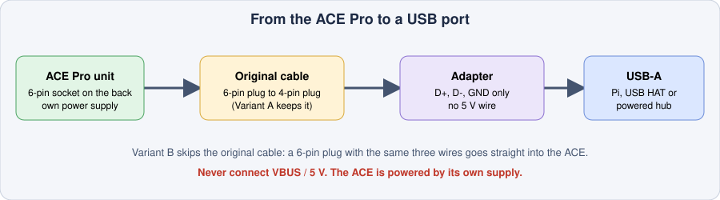
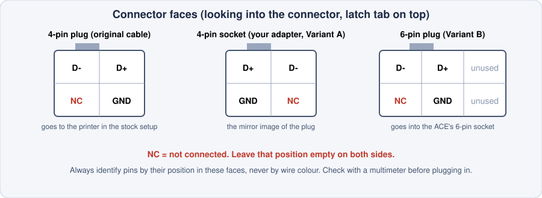

# Hardware and wiring

What you need to run the ACE Pro on a Klipper printer, and how to connect it by USB.

> **The pinouts on this page come from the Kobra-S1/ACEPRO documentation and the community adapter builds linked at the bottom. I have not re-measured them on every unit. Check your adapter with a multimeter before plugging it in** (section 4).

## 1. What you need

| Part | Required | Notes |
|---|---|---|
| 1 to 3 Anycubic Color Engine Pro units | Yes | Tested here with two (T0–T7). |
| USB cable or adapter for each ACE | Yes | Section 3 shows how to build one. |
| **Toolhead filament sensor** (close to the hotend) | Yes | Detects runout and tells the driver when filament reaches the nozzle. |
| **RDM sensor** (the splitter or "return module") | Optional | Lets the driver check the path and confirm an unload. |
| **Filament cutter** | Recommended | Gives clean tool changes. This setup uses a mechanical cutter pushed by the toolhead (see the main README, section 9). |
| Poop bucket and servo basket | Optional | Catches the purge. The servo here is an EZMAX ES3004. |
| Klipper host with free USB ports | Yes | A Pi 5 with a USB HAT works. Give the ACE a powered hub if the ports are weak. |

The sensor pins are set in `acepro.cfg` (section 4.2 of the main README).

## 2. Which ACE do you have?

| Unit | What the 4-pin connector carries | What to use |
|---|---|---|
| **ACE Pro** (first generation) | Native USB data | A plain USB-A adapter (below). It appears in Linux as `/dev/ttyACM*`. |
| **ACE 2 Pro** | RS-485, not USB | The RS485-to-USB conversion cable from Anycubic's ACE 2 kit for the KS1 / K3. A home-made USB cable will not work, and the Kobra-X / KS1-Max cable is not the same part. |

The driver detects which protocol a unit speaks (`protocol: auto` in `acepro_setting.cfg`). The rest of this page is about the first-generation ACE Pro, which is what this setup uses.

## 3. USB adapter for the ACE Pro

<div align="center">

</div>

Only **three wires** are used: **D+, D- and GND**. Do **not** connect VBUS (5 V). The ACE has its own power supply, and a second 5 V source on the data cable can damage the Pi or the unit.

Stock cable: the ACE's 6-pin socket takes a 6-pin plug. The other end of the cable is a 4-pin plug that normally goes into an Anycubic printer. You can adapt either end:

| | Variant A: adapt the printer end | Variant B: adapt the ACE end |
|---|---|---|
| Original cable | Kept as it is | Not used |
| You build | A 4-pin socket to USB-A adapter | A 6-pin plug to USB-A cable |
| Donor part | A 4-pin ACE extension cable (cut one end off) | A 6-pin plug or pigtail |
| Good if | You want to keep the original cable and be able to go back to it | You want the shortest path or a tidy back cover |

<div align="center">

</div>

### Wiring

| ACE signal | USB-A pin |
|---|---|
| D+ | 3 |
| D- | 2 |
| GND | 4 |
| NC (not connected) | 1 (VBUS) left unconnected |

- The plug and the socket faces are mirror images of each other. That is normal for connectors that mate.
- Use the **position** in the diagram to find each pin. Wire colours differ between cable makers.
- The 6-pin plug has the same 2×2 signal block in two columns, plus a third column with no contacts.

## 4. Check before you plug in

With a multimeter (no ACE connected, nothing powered):

1. **Continuity:** D+ to USB pin 3, D- to USB pin 2, GND to USB pin 4.
2. **No shorts:** D+ to D-, D+ to GND and D- to GND must not beep.
3. **VBUS:** USB pin 1 must not be connected to anything on the ACE side.

Then plug it in, power the ACE, and on the Pi:

```bash
ls /dev/serial/by-id/          # the ACE should be listed
```

Restart Klipper and run `ACE_GET_STATUS`.

## 5. Raspberry Pi 5 with a USB HAT

On a Pi 5 with the Waveshare PCIe to USB HAT+, the ACE units, the toolhead MCU and the expander board can all connect to the HAT. A kernel update broke the HAT's USB controller on my Pi. See "Raspberry Pi 5 + USB HAT" in the main README's troubleshooting section.

## 6. Ready-made adapters and references

- Printable adapter: <https://www.printables.com/model/1163780-anycubic-ace-pro-usb-a-adapter>
- Printable USB-C back cover: <https://www.printables.com/model/1227630-anycubic-acepro-back-cover-for-usb-c>
- Pinout and adapter documentation: [Kobra-S1/ACEPRO](https://github.com/Kobra-S1/ACEPRO)
