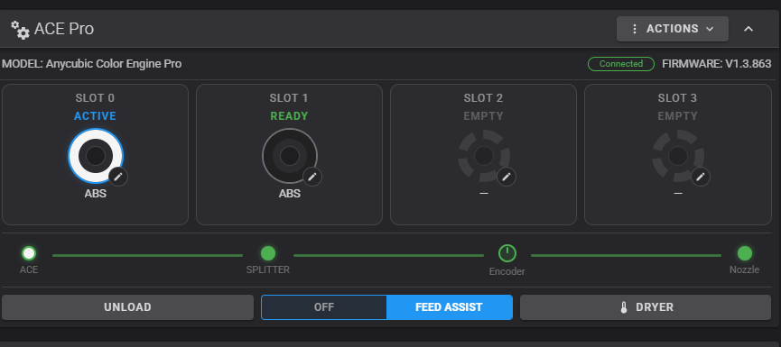
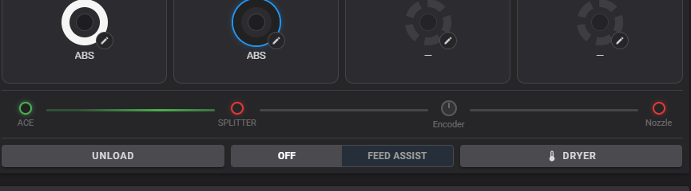
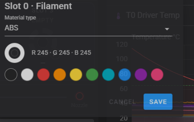

# Fluidd ACE Pro panel

An ACE Pro dashboard card for [Fluidd](https://github.com/fluidd-core/fluidd),
designed for the [acepro-any-klipper](https://github.com/ducati1198/acepro-any-klipper)
driver. Mirrors the functionality of the bundled KlipperScreen panel for the
browser dashboard.



## Features

- **Slot tiles** - each slot is a rounded tile with the spool, material and
  RFID info; click the spool to load (`T<n>`), the pencil icon edits material
  type and color (persisted via `ACE_SET_SLOT`). Dark filament colors keep
  their real color with a light outer ring for contrast.
- **Filament path** - live `ACE -> SPLITTER -> Encoder -> Nozzle` view driven
  by the filament sensors configured in Klipper:
  - green filled dot - sensor sees filament;
  - hollow red dot - sensor present, no filament;
  - while loading/unloading, the segment the filament is currently travelling
    through shows an animated flow, in load and unload direction;
  - the encoder only lights when the splitter has filament - an empty
    splitter darkens the encoder regardless of its own sensor;
  - nodes hide automatically when the sensor is not configured, so the path
    adapts to any hardware setup (also matches `filament_tracker`-style
    encoder sensors).
- **Jam indicator** - the encoder ring turns red when filament is at the
  nozzle but not at the encoder.
- **Feed assist switch** - segmented OFF / FEED ASSIST toggle using the
  driver's native `ACE_ENABLE_FEED_ASSIST T=` / `ACE_DISABLE_FEED_ASSIST T=`;
  click anywhere on the switch to toggle.
- **Dryer dialog** - chamber temperature, DRYING/IDLE with remaining time,
  temperature slider (50-65 C, step 5), duration slider (30-240 min, step 30).





- Service actions: load all slots, full unload, reconnect, request status.

## Requirements

- Node.js >= 18, ~2 GB free disk for the build.
- The ACE driver objects must be visible in the API
  (`printer.ace`, `printer.ace_instance_<n>`).

## Install

```bash
cd fluidd
bash install.sh
```

Optional environment variables:

```bash
FLUIDD_DIR=/path/to/fluidd-checkout WEBROOT=/usr/share/fluidd bash install.sh
KEEP_REPO=1 bash install.sh   # keep the built tree for debugging
```

The script checks Node, clones a fresh Fluidd (or uses `FLUIDD_DIR`), copies
the panel, applies the anchor-based patches to `Dashboard.vue` and the layout
state, builds, backs up the current webroot as `webroot.bak-ace-<timestamp>`
and deploys.

No build tools on the host? A prebuilt bundle is attached to the
[fluidd-ace-panel releases](https://github.com/sanakess/fluidd-ace-panel/releases/latest) —
unpack it over your Fluidd webroot and hard-reload.

After install, reload the browser with **Ctrl+Shift+R** and clear the service
worker if the card does not appear (DevTools -> Application -> Storage).

The card appears on the dashboard automatically whenever the ACE driver is
present and hides itself when ACE is disconnected.

## License

GPL-3.0 (derivative work of Fluidd, GPLv3).
