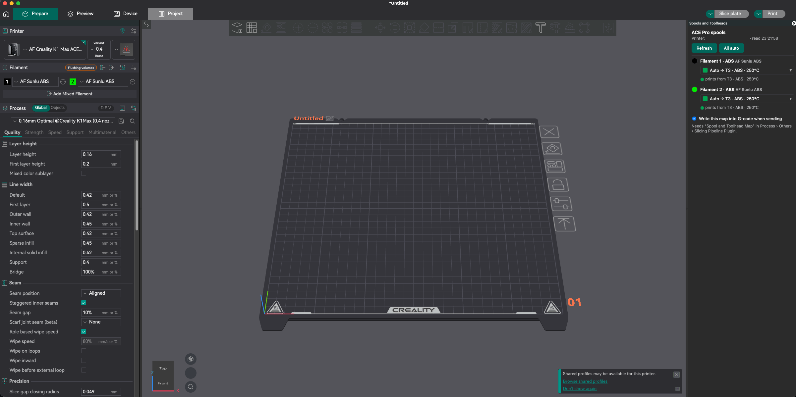
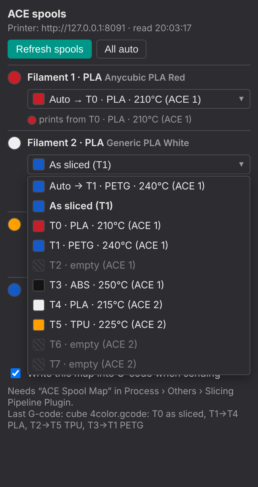

# ACE Spool Mapper – OrcaSlicer 2.5 plugin

> **New: one plugin for both printers.** [`spool_toolhead_mapper.py`](spool_toolhead_mapper.py) combines the ACE Spool Mapper (ACE Pro, acepro-any-klipper) and the WM Toolhead Mapper (WonderMaker ZR Ultra-S). It asks the printer (Moonraker) what it is: a printer with the `ace` object gets the ACE panel and `ACE_SET_TOOL_MAP`; a printer with the WonderMaker `filament0..3` sensors gets the toolhead panel and `WM_SET_TOOL_MAP`; any other printer is left alone (nothing is written into its G-code). Install it the same way as below (**Install local plugin**), enable its two parts (**Spools and Toolheads** and **Spool and Toolhead Map**), add **Spool and Toolhead Map** in Process > Others > Slicing Pipeline Plugin, and remove the older plugin first so the line is not written twice. It uses the print host of each printer preset, so set that on every printer preset.



**Keep the file name `spool_toolhead_mapper.py`.** Orca builds the plugin's name from the file name, so a dot or a space in it (for example `spool_toolhead_mapper 2.py` or `..._0.7.1.py`) makes the plugin fail to activate with no message.

**Printer address:** if Orca does not give the plugin a print host, the panel has an address box at the top: type the printer's address once for each printer preset (for example `10.11.88.30`) and press **Save address**. A grey status line shows when a button press was sent and answered, and `~/.spool_toolhead_mapper.log` records what the plugin read and showed. A printer with both the ACE driver and the WonderMaker toolhead sensors is shown as the four toolheads; set `printer_kind` to `ace` in the plugin's config to force the ACE side.

**What the panel does for you:** it refreshes by itself when you switch printer preset (a few seconds), it remembers your picks per printer between Orca sessions (they are dropped when a filament's colour or type changes), and it shows hints under a filament when two filaments use the same slot or toolhead, when the colour is clearly different, or (WonderMaker) when the chosen toolhead shows empty. Empty WonderMaker toolheads can be picked, with a warning; empty ACE slots stay blocked. Picks are saved in `~/.spool_toolhead_mapper.json` (if Orca does not allow writing it, they last for the session).


Pick which ACE Pro spool prints each OrcaSlicer filament, right in Orca. Works with
**Upload and Print**, **Upload** and **Export G-code**.



## Needs

- OrcaSlicer 2.5 or newer (plugin system).
- This driver (`ACE_SET_TOOL_MAP` with `KEEP_EXISTING`) on the printer.
- The printer preset's host set to your printer (Printer settings → Connection), e.g. `192.168.1.50:7125`.

## Install (once)

1. In OrcaSlicer open **File → Plugins**.
2. **Browse plugins** (split button) → **Install local plugin** → pick `ace_spool_mapper.py`.
3. Orca asks once whether the plugin may connect to your printer – click **Yes**
   (remembered; covers every request to that host).
4. The plugin brings two parts: **ACE Spools** (the panel) and **ACE Spool Map** (the G-code step).
   If the Plugins window shows them disabled, enable both.
5. Turn on the G-code step: switch Orca to **Advanced** mode, open your **Process** settings →
   **Others** → **Slicing Pipeline Plugin**, add **ACE Spool Map**, save the process preset
   (for each process preset you print with).
6. Restart Orca. The **ACE Spools** panel docks on the right of the 3D view.

To use an address other than the printer preset's: Plugins → ACE Spool Mapper → **Config** → `printer_url`.
To stop the panel opening at start: same place, `open_on_start: false`. Reopen it from
**File → Plugins** → ▸ ACE Spool Mapper → ▶ on the **ACE Spools** row.

## Use

1. In the panel, each project filament shows its best ACE spool (**Auto →**: same material,
   closest colour, each spool once). Change any row to a specific spool or **As sliced**.
   Picks are kept until that filament's colour or type changes.
2. Slice and use **Upload and Print** (or Upload / Export) as usual. Sending never opens a window
   (Orca runs the step in the background), so set spools in the panel first.

The G-code gets one line before the start G-code:

```
; ACE Spool Mapper: T0 as sliced, T1->T4 PLA, T3->T1 PETG
ACE_SET_TOOL_MAP MAP=1:4,3:1 FILE="benchy.gcode" KEEP_EXISTING=1
```

The printer then loads ACE slot T4 whenever the file asks for T1, and so on, for that print only.

## Good to know

- Only tools the G-code really uses are mapped.
- Without the panel open, the step reads the spools from the printer and uses your saved picks or
  the automatic match; if the printer can't be reached it uses the last spool list; with none at
  all the file prints as sliced.
- Untick **Write this map into G-code when sending** in the panel to switch it off.
- Starting the same file from Fluidd with its spool picker: the Fluidd choice wins (`KEEP_EXISTING=1`).
- Orca's preview shows the G-code before the plugin step; the inserted line is only in the sent file.
